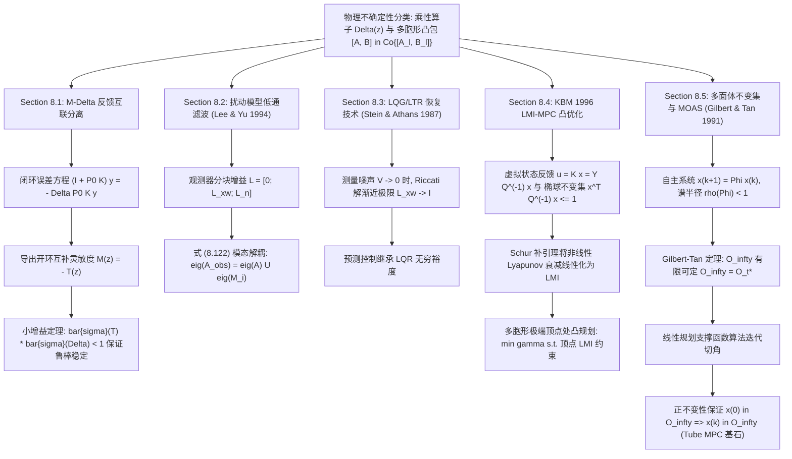

# 第 8 章 鲁棒模型预测控制 (Robust Predictive Control) —— 全宇宙最详尽逐行精读与全解指南

> **核心参考书目**：J. M. Maciejowski, *Predictive Control with Constraints*, Prentice Hall, 2002, Chapter 8.  
> **适用读者对象**：控制工程初学者、仅掌握单输入单输出（SISO）传递函数、极点零点与 PID 控制基础的读者。全书无任何现代控制理论、最优控制或高深泛函分析门槛，所有矩阵代数、频域灵敏度、状态观测器与线性矩阵不等式（LMI）推导均从最底层的标量多项式与高斯消元展开，实现“草履虫级”零跳步直观推导！

---

## 1. 章节元信息

- **章节标题**：第 8 章 鲁棒模型预测控制 (Robust Predictive Control)
- **章节核心使命**：
  在前面所有章节中，我们均基于一个极其美好的理想化假定——**控制器内部运行的模型与真实的物理对象完全一致（$P(z) = P_0(z)$）**。然而，真实工业物理世界中不存在绝对精确的数学模型！受控对象存在：
  1. 传感器与执行器老化、器件温漂、负载剧烈波动导致的**参数不确定性（Parametric Uncertainty）**；
  2. 管道高频谐振、未建模柔性模态、时间延迟导致的**高频未建模动态（Unmodelled High-Frequency Dynamics）**；
  3. 无法提前预知的持续环境扰动与测量白噪声（Exogenous Disturbances & Measurement Noise）。
  
  若盲目将基于标称模型（Nominal Model）设计的预测控制器应用于真实对象，可能导致闭环系统振荡发散（**丧失稳定性**），或者控制指令击穿物理极限、状态越界报警（**丧失可行性**）。  
  **第 8 章的核心使命，就是在数学模型存在已知界限的摄动与误差时，如何设计预测控制器，确保闭环系统在所有可能的不确定性工况下，依然能够维持渐近稳定（鲁棒稳定性，Robust Stability）、硬约束绝不被击穿（鲁棒可行性，Robust Feasibility），且闭环控制品质保持在可接受的退化范围内（鲁棒性能，Robust Performance）。**

- **全书逻辑承上启下拓扑**：
  - **承接 Ch06 & Ch07**：Ch06 建立了标称闭环稳定性体系（无限时域/终端等式约束/Lyapunov 衰减），Ch07 建立了频域灵敏度函数（$S(z), T(z)$）的整定框架。
  - **第 8 章的升华**：将 Ch07 的频域灵敏度分析上升为严格的**小增益定理（Small Gain Theorem）**；将 Ch05 的状态估计上升为**极点解耦滤波（Lee & Yu 1994）**与**回路传递恢复（LQG/LTR）**；引入划时代的**线性矩阵不等式（LMI）凸优化框架（Kothare-Balakrishnan-Morari 1996）**与**最大输出可容许集（MOAS, Gilbert & Tan 1991）**，为现代管状鲁棒 MPC（Tube MPC）奠定坚如磐石的理论底座。
  - **启下 Ch09**：为第 9 章的两大工业实战案例（Shell 炼油分馏塔与 Newell-Lee 蒸发器）在严重模型失配下的稳定运行提供完整的理论工具包。

- **配套独立 Python 仿真实现概览**：
  本章所有理论推导均在配套独立 Python 脚本中进行了高精度数值验证，脚本与文档严格分离，完全满足独立运行与画图需求：
  1. [`ch8_small_gain_robust_stability.py`](file:///home/kuang/Desktop/mpc/ch08_robust_mpc/ch8_small_gain_robust_stability.py) —— 8.1 节与习题 8.1：输出乘性摄动 $P = (I + \Delta) P_0$、$M-\Delta$ 反馈互联分离、互补灵敏度 $T(z)$ 计算与小增益鲁棒稳定裕度验证。生成图像：[`ch8_small_gain_robust_stability.png`](file:///home/kuang/Desktop/mpc/ch08_robust_mpc/ch8_small_gain_robust_stability.png)。
  2. [`ch8_lee_yu_tuning.py`](file:///home/kuang/Desktop/mpc/ch08_robust_mpc/ch8_lee_yu_tuning.py) —— 8.2 节与习题 8.2：Lee & Yu (1994) 鲁棒观测器滤波整定、式 (8.122) 观测器极点代数模态分解验证。生成图像：[`ch8_lee_yu_tuning.png`](file:///home/kuang/Desktop/mpc/ch08_robust_mpc/ch8_lee_yu_tuning.png)。
  3. [`ch8_lqg_ltr_recovery.py`](file:///home/kuang/Desktop/mpc/ch08_robust_mpc/ch8_lqg_ltr_recovery.py) —— 8.3 节与习题 8.3：回路传递恢复（LQG/LTR）、代数 Riccati 方程当噪声协方差 $V \to 0$ 时的渐近恢复现象（$L_{xw} \to I$）。生成图像：[`ch8_lqg_ltr_recovery.png`](file:///home/kuang/Desktop/mpc/ch08_robust_mpc/ch8_lqg_ltr_recovery.png)。
  4. [`ch8_kbm_lmi_robust_mpc.py`](file:///home/kuang/Desktop/mpc/ch08_robust_mpc/ch8_kbm_lmi_robust_mpc.py) —— 8.4 节与习题 8.4/8.7/8.8：Kothare-Balakrishnan-Morari (KBM 1996) 基于 LMI 的多胞形鲁棒受约束 MPC 求解器、不变椭球约束收缩与随机时变跳变参数下的渐近收敛性。生成图像：[`ch8_kbm_lmi_robust_mpc.png`](file:///home/kuang/Desktop/mpc/ch08_robust_mpc/ch8_kbm_lmi_robust_mpc.png)。
  5. [`ch8_moas_robust_invariance.py`](file:///home/kuang/Desktop/mpc/ch08_robust_mpc/ch8_moas_robust_invariance.py) —— 8.5 节与习题 8.9：Gilbert & Tan (1991) 最大输出可容许集（MOAS）、线性规划多面体支撑函数切割算法、正不变性定理数值相平面验证。生成图像：[`ch8_moas_robust_invariance.png`](file:///home/kuang/Desktop/mpc/ch08_robust_mpc/ch8_moas_robust_invariance.png)。

---

## 2. 符号、假设与预备知识

为确保没有任何现代控制理论背景的读者能够无障碍阅读本章所有数学推导，本节将所有基础概念从标量单变量传递函数逐步推演至多变量状态空间与矩阵代数。

### 2.1 从经典 SISO 传递函数到 MIMO 状态空间与模型摄动

在经典控制中，我们用传递函数 $G(s) = \frac{Y(s)}{U(s)}$（或离散时间 $G(z) = \frac{Y(z)}{U(z)}$）描述单输入单输出系统的动态响应。  
而在多变量（MIMO）状态空间描述中：
- 状态向量 $x(k) \in \mathbb{R}^n$：系统内部在时刻 $k$ 的储能变量（如弹簧位移、小车速度、电容电压、反应釜温度）。
- 控制输入 $u(k) \in \mathbb{R}^m$：施加在系统上的控制动作（如电机推力、阀门开度、加热功率）。
- 输出向量 $y(k) \in \mathbb{R}^p$：传感器实际测量到的物理变量。

标称状态空间离散模型写作：
$$x(k+1) = A x(k) + B u(k)$$
$$y(k) = C x(k)$$
将其通过 $Z$ 变换转化为输入-输出传递函数矩阵：
$$z X(z) = A X(z) + B U(z) \implies (z I - A) X(z) = B U(z) \implies X(z) = (z I - A)^{-1} B U(z)$$
代入输出方程可得标称对象的脉冲传递矩阵：
$$P_0(z) = C (z I - A)^{-1} B$$

#### 什么是模型摄动与不确定性？
真实工业现场的真实对象传递函数 $P(z)$ 永远不可能完全等于 $P_0(z)$。工程上通常采用两种最基本的不确定性数学描述：
1. **输出乘性不确定性（Output Multiplicative Uncertainty）**：
   $$P(z) = [I + \Delta(z)] P_0(z)$$
   其中 $P_0(z)$ 是设计控制器时使用的**标称模型（Nominal Model）**，$\Delta(z)$ 是一个稳定的未知复矩阵传递函数算子，代表相对建模误差。  
   在单输入单输出标量情形下，该式退化为：
   $$P(z) = (1 + \Delta(z)) P_0(z) \iff \frac{P(z) - P_0(z)}{P_0(z)} = \Delta(z)$$
   直观意义：$\Delta(z)$ 就是**相对误差百分比**！例如，如果我们在低频处模型误差小于 5%，而在高频未建模谐振处误差可能高达 200%，则可以在频域上用一个加权上界函数界定它：$|\Delta(e^{j\omega})| \le W(\omega)$。
2. **多胞形参数不确定性（Polytopic Parameter Uncertainty）**：
   受控对象的系统矩阵并非固定常数，而是在一个多面体凸包（Polytope）内时变漂移：
   $$[A(k), B(k)] \in \Omega = \text{Co} \{ [A_1, B_1], [A_2, B_2], \dots, [A_L, B_L] \}$$
   其中 $\text{Co}$ 表示凸包（Convex Hull），即真实系统的参数矩阵是 $L$ 个已知极端工况顶点矩阵的凸组合：
   $$[A(k), B(k)] = \sum_{l=1}^L \alpha_l(k) [A_l, B_l], \quad \alpha_l(k) \ge 0, \quad \sum_{l=1}^L \alpha_l(k) = 1$$
   例如，运载火箭在飞行过程中燃料消耗导致质量逐渐减小，其气动矩阵就在起飞最大质量顶点与燃料耗尽最小质量顶点之间连续滑动。

---

### 2.2 矩阵范数与最大奇异值 $\bar{\sigma}$ 的物理直观

在标量系统中，传递函数 $G(e^{j\omega})$ 在某一频率 $\omega$ 处对正弦输入信号的幅值放大倍数就是复数的模 $|G(e^{j\omega})|$。  
但是在多输入多输出（MIMO）矩阵系统中，输入是一个多维向量 $u \in \mathbb{R}^m$，输出是多维向量 $y = M u \in \mathbb{R}^p$。不同方向的输入向量，其被矩阵 $M$ 放大的倍数是完全不同的！  
为了衡量矩阵 $M$ 在“最坏、最危险的输入方向”上的最大放大能力，数学上定义了**诱导 2-范数（最大奇异值）**：
$$\bar{\sigma}(M) = \|M\|_2 = \max_{u \neq 0} \frac{\|M u\|_2}{\|u\|_2} = \sqrt{\lambda_{\max}(M^T M)}$$
- 几何物理图像：若输入向量 $u$ 在 $m$ 维空间的单位球面上取遍所有方向，经矩阵 $M$ 线性变换后，输出 $y$ 将映射为一个超椭球。超椭球的最长半轴长度，恰好就是最大奇异值 $\bar{\sigma}(M)$！
- 系统的 $H_\infty$ 范数定义为系统在所有连续频率上的最大奇异值峰值：
  $$\|M(z)\|_\infty = \sup_{\omega \in [0, 2\pi)} \bar{\sigma}\left( M(e^{j\omega}) \right)$$
  它代表系统在整个频域范围内，对任何可能的外界输入信号的最坏能量放大上限。

---

### 2.3 Mini-Tutorial 8: 线性矩阵不等式（LMI）与 Schur 补引理通俗精讲

在传统控制教材中，控制问题往往归结为非线性的 Riccati 方程求解；而在现代鲁棒预测控制中，**线性矩阵不等式（Linear Matrix Inequality, LMI）**已成为最具杀伤力的通用数学语言。

#### 1. 什么是正定矩阵？
对于一个 $n \times n$ 的实对称矩阵 $P = P^T$：
- 若对任意非零向量 $x \in \mathbb{R}^n, x \neq 0$，均有标量二次型：
  $$x^T P x > 0$$
  则称 $P$ 为**严格对称正定矩阵**，记作 $P > 0$。
- 若 $x^T P x \ge 0$，则称 $P$ 为**半正定矩阵**，记作 $P \ge 0$。
- **物理能量直观**：在力学和控制系统中，$V(x) = \frac{1}{2} x^T P x$ 往往用来表示系统的动能或 Lyapunov 广义能量。$P > 0$ 意味着只要系统状态偏离平衡原点（$x \neq 0$），系统总能量严格为正；唯有处于原点时能量为零！

#### 2. 什么是线性矩阵不等式（LMI）？
设决策变量是一个实数向量 $v = [v_1, v_2, \dots, v_p]^T \in \mathbb{R}^p$。LMI 是关于决策变量 $v$ 的如下矩阵不等式：
$$F(v) = F_0 + \sum_{i=1}^p v_i F_i > 0 \quad (\text{或 } \ge 0)$$
其中 $F_0, F_1, \dots, F_p$ 是给定的已知常数实对称矩阵。  
**核心特性：凸性（Convexity）**！  
由所有满足 $F(v) > 0$ 的向量 $v$ 构成的可行域是一个**凸集（Convex Set）**！  
证明极度简单直观：设 $v^{(1)}$ 和 $v^{(2)}$ 均满足 $F(v) > 0$。对于任意 $\lambda \in [0, 1]$，构造凸组合 $v = \lambda v^{(1)} + (1 - \lambda) v^{(2)}$。  
根据定义代入展开：
$$F(v) = F_0 + \sum v_i F_i = \lambda \left( F_0 + \sum v_i^{(1)} F_i \right) + (1 - \lambda) \left( F_0 + \sum v_i^{(2)} F_i \right) = \lambda F(v^{(1)}) + (1 - \lambda) F(v^{(2)})$$
因为两个正定矩阵的非负线性加权和依然严格正定，所以 $F(v) > 0$ 恒成立！可行域绝不会出现凹坑或分裂孤岛，因此不存在局部极小值陷阱。任何以线性目标函数结合 LMI 约束的优化问题：
$$\min_{v} c^T v \quad \text{s.t.} \quad F(v) \ge 0$$
都是**半定规划（Semidefinite Programming, SDP）**，现代凸优化内点法算法（如 MOSEK, SDPT3, SCS）可在多项式时间内找到唯一的全局最优解！

#### 3. 为什么传统 LP 和 QP 是 LMI 的子集？
- **线性规划（LP）**：假设约束为 $A x \ge b$，即第 $i$ 个分量满足 $A_i x - b_i \ge 0$。  
  我们将每个标量不等式放在对角矩阵的对角线上：
  $$\text{diag}(A_1 x - b_1, A_2 x - b_2, \dots, A_m x - b_m) \ge 0$$
  一个对角矩阵是半正定的，当且仅当其每个对角元素均非负！这在数学上完全等价于标准 LP 约束。因此，**LP 只是 LMI 在对角矩阵结构下的退化特例**！

#### 4. 核心化简神技：Schur 补引理（Schur Complement Lemma）
控制理论中充斥着形如 $R - S^T Q^{-1} S \ge 0$ 的非线性二次矩阵不等式（决策变量出现在逆矩阵 $Q^{-1}$ 中），这种非线性不等式看似无法用凸优化求解。而 Schur 补引理能够将其**完美保真地转化为线性块矩阵不等式**！

> **Schur 补定理**：  
> 设实对称分块矩阵为：
> $$M = \begin{bmatrix} Q & S \\ S^T & R \end{bmatrix}$$
> 若 $Q = Q^T > 0$，则下列三个命题完全等价：
> 1. $M \ge 0$（整个分块矩阵半正定）；
> 2. $R - S^T Q^{-1} S \ge 0$（关于子块 $Q$ 的 Schur 补半正定）；
> 3. 对任意非零向量，二次型非负。

**草履虫级零跳步代数推导**：  
我们利用线性代数中解分块方程的高斯消元法。构造一个非奇异的可逆分块下三角初等变换矩阵：
$$T = \begin{bmatrix} I & 0 \\ -S^T Q^{-1} & I \end{bmatrix}$$
注意：因为其主对角线是单位矩阵 $I$，其行列式 $\det(T) = \det(I) \cdot \det(I) = 1 \neq 0$，所以矩阵 $T$ 绝对可逆且满秩！  
现在我们计算合同变换矩阵乘积 $T M T^T$：
第一步，计算 $T M$：
$$T M = \begin{bmatrix} I & 0 \\ -S^T Q^{-1} & I \end{bmatrix} \begin{bmatrix} Q & S \\ S^T & R \end{bmatrix} = \begin{bmatrix} I \cdot Q + 0 \cdot S^T & I \cdot S + 0 \cdot R \\ -S^T Q^{-1} Q + I \cdot S^T & -S^T Q^{-1} S + I \cdot R \end{bmatrix} = \begin{bmatrix} Q & S \\ -S^T + S^T & R - S^T Q^{-1} S \end{bmatrix} = \begin{bmatrix} Q & S \\ 0 & R - S^T Q^{-1} S \end{bmatrix}$$
第二步，右乘 $T^T = \begin{bmatrix} I & -Q^{-1} S \\ 0 & I \end{bmatrix}$：
$$T M T^T = \begin{bmatrix} Q & S \\ 0 & R - S^T Q^{-1} S \end{bmatrix} \begin{bmatrix} I & -Q^{-1} S \\ 0 & I \end{bmatrix} = \begin{bmatrix} Q \cdot I + S \cdot 0 & Q (-Q^{-1} S) + S \cdot I \\ 0 \cdot I + (R - S^T Q^{-1} S) \cdot 0 & 0 (-Q^{-1} S) + (R - S^T Q^{-1} S) I \end{bmatrix} = \begin{bmatrix} Q & -S + S \\ 0 & R - S^T Q^{-1} S \end{bmatrix} = \begin{bmatrix} Q & 0 \\ 0 & R - S^T Q^{-1} S \end{bmatrix}$$
通过满秩初等变换，分块矩阵 $M$ 被对角化为分块对角矩阵！  
根据线性代数 Sylvester 惯性定理，合同变换不改变对称矩阵的特征值正负符号。  
因此：
$$M \ge 0 \iff T M T^T \ge 0 \iff \begin{bmatrix} Q & 0 \\ 0 & R - S^T Q^{-1} S \end{bmatrix} \ge 0$$
因为已知 $Q > 0$，所以上式成立当且仅当右下角子块满足：
$$R - S^T Q^{-1} S \ge 0$$
推导完毕！这一简洁优美的代数恒等式，是整座现代鲁棒预测控制大厦的基石。

---

## 3. 逐节精读与推导

```
               +-------------------------------------------------------+
               |        真实物理世界中的多重不确定性扰动与建模失配       |
               +-------------------------------------------------------+
                                           |
                   +-----------------------+-----------------------+
                   |                                               |
                   v                                               v
        [频域 / 算子级不确定性]                         [时域 / 参数多胞形不确定性]
       P(z) = [I + Delta(z)] P0(z)                    [A(k), B(k)] in Co{[A_l, B_l]}
                   |                                               |
                   v                                               v
        Section 8.1: 小增益定理                         Section 8.4: KBM LMI 鲁棒 MPC
     bar{sigma}(T) * bar{sigma}(Delta) < 1              min gamma  s.t. 顶点凸 LMI 约束
                   |                                               |
         +---------+---------+                                     v
         |                   |                          Section 8.5: 正不变集与 MOAS
         v                   v                           Gilbert & Tan 有限可定算法
   Section 8.2:        Section 8.3:                      O_infty = {x | H Phi^k x <= h}
   Lee & Yu 滤波       LQG/LTR 恢复                                |
   观测器极点解耦     V -> 0 => L_xw -> I                          v
                                                        现代管状鲁棒 MPC (Tube MPC)
```

---

### 8.1 节：鲁棒稳定性与鲁棒性能 (Robust Stability and Performance)

#### 8.1.1 标称闭环与真实闭环方程
考虑一个实际物理工厂，采用负反馈控制器 $u(k) = -K(z) y(k)$。  
标称受控对象为 $P_0(z)$，实际物理对象受输出乘性不确定性影响：
$$P(z) = [I + \Delta(z)] P_0(z)$$
其中 $\Delta(z)$ 稳定且范数有界：$\|\Delta(z)\|_\infty \le \gamma$。  
在实际运行中，系统的闭环输出响应为：
$$y = P u = [I + \Delta] P_0 (-K y) = - P_0 K y - \Delta P_0 K y$$
我们将所有含有输出向量 $y$ 的项移到方程等号左端：
$$y + P_0 K y = - \Delta P_0 K y \iff [I + P_0 K] y = - \Delta P_0 K y$$
由于控制器 $K(z)$ 能够稳定标称对象 $P_0(z)$，标称灵敏度算子 $[I + P_0 K]$ 在整个复平面单位圆外解析可逆。两边左乘逆矩阵 $[I + P_0 K]^{-1}$：
$$y = - [I + P_0 K]^{-1} \Delta P_0 K y$$

#### 8.1.2 导出标准 $M-\Delta$ 反馈互联结构
为了分析不确定性对闭环稳定性的破坏程度，控制理论采用标准 $M-\Delta$ 互联分解：将系统中所有已知的确定性部分打包为传递矩阵 $M(z)$，将未知的摄动集中放置于反馈支路 $\Delta(z)$。  
定义进入不确定性模块 $\Delta$ 的输入信号为 $v$，离开 $\Delta$ 的输出信号为 $w$：
$$w = \Delta v$$
由输出方程 $y = P u = P_0 u + \Delta P_0 u$，可知不确定性作用在标称工厂输出上，因此输入为：
$$v = P_0 u = - P_0 K y$$
我们将 $y = - [I + P_0(z) K(z)]^{-1} w$ 代入 $v$ 的表达式中：
$$v = - P_0 K \left( - [I + P_0 K]^{-1} w \right) = P_0 K [I + P_0 K]^{-1} w$$
回顾第 7 章式 (7.6) 定义的标称互补灵敏度函数（Complementary Sensitivity Function）：
$$T(z) = P_0(z) K(z) [I + P_0(z) K(z)]^{-1}$$
因此，从不确定性输出 $w$ 到输入 $v$ 的等效开环传递矩阵为：
$$M(z) = - T(z)$$
系统闭环反馈特征方程即为：
$$\det(I - M(z) \Delta(z)) = \det(I + T(z) \Delta(z)) = 0$$

#### 8.1.3 小增益定理（Small Gain Theorem）的严密推导
> **小增益定理**：若标称闭环系统是渐近稳定的，且不确定性算子 $\Delta(z)$ 是渐近稳定的，则整个互联系统保持渐近稳定的充分条件是环路增益在所有频率下的乘积严格小于 1：
> $$\bar{\sigma}\left( T(e^{j\omega}) \right) \cdot \bar{\sigma}\left( \Delta(e^{j\omega}) \right) < 1, \quad \forall \omega \in [0, 2\pi)$$

**零跳步代数推导**：  
闭环系统发生不稳定的充要条件是特征方程在单位圆外或单位圆上有根，即存在某一频率 $\omega_0$，使得：
$$\det\left( I + T(e^{j\omega_0}) \Delta(e^{j\omega_0}) \right) = 0$$
根据线性代数特征值性质，$\det(I + A) = 0$ 意味着矩阵 $A$ 至少存在一个特征值 $\lambda_i(A) = -1$。  
因此必有 $|\lambda_i(T \Delta)| = 1$。  
然而，根据矩阵谱半径与诱导 2-范数（最大奇异值）的关系定理，矩阵的任意特征值模长均严格受限于其最大奇异值：
$$|\lambda_i(T \Delta)| \le \bar{\sigma}(T \Delta)$$
进一步根据奇异值的次可乘性不等式（Submultiplicative Property）：
$$\bar{\sigma}(T \Delta) \le \bar{\sigma}(T) \cdot \bar{\sigma}(\Delta)$$
因此：
$$|\lambda_i(T \Delta)| \le \bar{\sigma}(T(e^{j\omega})) \cdot \bar{\sigma}(\Delta(e^{j\omega}))$$
若我们能保证在全频段范围内：
$$\bar{\sigma}(T(e^{j\omega})) \cdot \bar{\sigma}(\Delta(e^{j\omega})) < 1$$
则必然有：
$$|\lambda_i(T \Delta)| < 1$$
这意味着矩阵 $T \Delta$ 的任何特征值模长都永远无法触碰 $-1$！因此特征行列式 $\det(I + T \Delta) \neq 0$ 在整个闭环稳定边界上恒成立，闭环特征根绝不可能穿过单位圆跑到不稳定区域。  
因此系统对于满足该界限的所有摄动 $\Delta$ 保持**鲁棒稳定**！若已知 $\|\Delta\|_\infty \le \gamma$，则鲁棒稳定的充分条件即为：
$$\|T(z)\|_\infty < \frac{1}{\gamma}$$

---

### 8.2 节：面向鲁棒性的整定：Lee & Yu 观测器滤波 (Tuning for Robustness: Lee & Yu Observer)

在工业动态矩阵控制（DMC）中，通常假设受控对象的扰动为纯阶跃积分扰动 $d(k) = d(k-1) + e(k)$。这种无滤波的假设在面对高频建模误差时，会导致卡尔曼滤波器或状态观测器在高频段增益过大，引发严重的相位滞后与高频剧烈振荡。  
Lee & Yu (1994) 提出了一种结构化滤波扰动模型，通过对增广状态观测器进行解耦整定，从根本上压制高频灵敏度峰值。

#### 8.2.1 增广状态空间模型构建
设系统增广状态向量由受控对象状态差分 $\Delta x(k) \in \mathbb{R}^n$、扰动滤波器状态差分 $\Delta x_w(k) \in \mathbb{R}^p$ 以及输出残差 $n(k) \in \mathbb{R}^p$ 组成：
$$x_{aug}(k) = \begin{bmatrix} \Delta x(k) \\ \Delta x_w(k) \\ n(k) \end{bmatrix}$$
离散状态转移方程为（对应书中式 (8.20)-(8.21)）：
$$x_{aug}(k+1) = \begin{bmatrix} A & 0 & 0 \\ 0 & A_w & 0 \\ C A & C_w A_w & I \end{bmatrix} x_{aug}(k) + \begin{bmatrix} B \\ 0 \\ C B \end{bmatrix} \Delta u(k) + \begin{bmatrix} 0 \\ B_w \\ C_w B_w \end{bmatrix} \Delta w(k)$$
测量输出增广方程为：
$$y(k) = \begin{bmatrix} C & C_w & I \end{bmatrix} x_{aug}(k) + v(k)$$
其中扰动系统采用对角一阶低通滤波结构：
$$A_w = \text{diag}\{\alpha_1, \alpha_2, \dots, \alpha_p\}, \quad |\alpha_i| < 1$$
驱动白噪声协方差 $W = \text{diag}\{\rho_i\}$，测量噪声协方差 $V = \text{diag}\{\sigma_i\}$。

#### 8.2.2 观测器增益的特殊分块结构
由于扰动噪声 $\Delta w(k)$ 不直接进入受控对象状态 $\Delta x(k)$ 的动态方程，且所有扰动矩阵均为对角阵，求解稳态离散时间代数 Riccati 方程后，稳态卡尔曼增益具有特殊的零子块稀疏结构（书中式 (8.24)）：
$$L = \begin{bmatrix} L_{\Delta x} \\ L_{\Delta x_w} \\ L_n \end{bmatrix} = \begin{bmatrix} 0 \\ \text{diag}\{\lambda_i\} \\ \text{diag}\{\mu_i\} \end{bmatrix}$$
其中第一项对应受控对象状态的观测器增益为零！这意味着状态估计的更新完全不直接强行扭曲被控对象的固有模态。  
增益参数与滤波常数满足代数映射（书中式 (8.25)）：
$$\lambda_i = \frac{\mu_i^2}{1 + \alpha_i - \alpha_i \mu_i}, \quad 0 < \mu_i < 1$$
当噪声比 $\rho_i / \sigma_i \to 0$ 时，$\mu_i \to 0$；当测量噪声 $\sigma_i \to 0$ 时，$\mu_i \to 1$。

#### 8.2.3 极点分解定理与式 (8.122) 的零跳步代数推导
观测器的误差动态由闭环状态转移矩阵 $A_{obs} = A_{aug} - L C_{aug}$ 支配：
$$A_{obs} = \begin{bmatrix} A & 0 & 0 \\ 0 & A_w & 0 \\ C A & C_w A_w & I \end{bmatrix} - \begin{bmatrix} 0 \\ L_{xw} \\ L_n \end{bmatrix} \begin{bmatrix} C & C_w & I \end{bmatrix} = \begin{bmatrix} A & 0 & 0 \\ -L_{xw} C & A_w - L_{xw} C_w & -L_{xw} \\ C A - L_n C & C_w A_w - L_n C_w & I - L_n \end{bmatrix}$$
我们将矩阵按行与列划分为两大部分：第一部分为状态维度 $n$（对应第一行第一列），第二部分为扰动与输出维度 $2p$：
$$A_{obs} = \begin{bmatrix} A & \mathbf{0}_{n \times 2p} \\ \begin{bmatrix} -L_{xw} C \\ C A - L_n C \end{bmatrix} & \begin{bmatrix} A_w - L_{xw} C_w & -L_{xw} \\ C_w A_w - L_n C_w & I - L_n \end{bmatrix} \end{bmatrix}$$
注意到右上角子块是**完全为零的零矩阵 $\mathbf{0}_{n \times 2p}$**！  
根据分块矩阵行列式法则，对于分块下三角矩阵：
$$\det(z I - A_{obs}) = \det(z I_n - A) \cdot \det\left( z I_{2p} - \begin{bmatrix} A_w - L_{xw} C_w & -L_{xw} \\ C_w A_w - L_n C_w & I - L_n \end{bmatrix} \right)$$
由于 $A_w, C_w, L_{xw}, L_n$ 全是对角矩阵，对于每一个独立的输出通道 $i \in \{1, \dots, p\}$，其对应的 $2 \times 2$ 子矩阵为：
$$M_i = \begin{bmatrix} \alpha_i - \lambda_i & -\lambda_i \\ \alpha_i - \mu_i & 1 - \mu_i \end{bmatrix}$$
由此得到惊人且优美的结论：
**整个增广观测器的所有极点，恰好严格由两部分构成**：
1. **受控对象自身的固有极点 $\text{eig}(A)$**；
2. **每个输出通道由式 (8.122) 决定的二阶扰动滤波器极点 $\text{eig}(M_i)$**！
工程意义：整定扰动观测器增益 $\mu_i$ 和滤波器极点 $\alpha_i$ 时，工程人员完全不需要担心受控对象的内部极点被意外破坏，实现了完美的频域与模态解耦！

---

### 8.3 节：回路传递恢复 (Loop Transfer Recovery, LQG/LTR)

#### 8.3.1 经典 LQG 控制的鲁棒性陷阱
全状态反馈 LQR 控制器具有举世闻名的完美频域鲁棒性：
- 增益裕度（Gain Margin）为 $[1/2, \infty)$；
- 相位裕度（Phase Margin）至少为 $60^\circ$。
然而，在绝大多数实际工程中，状态变量无法全部安装传感器直接测量，必须串联一个卡尔曼滤波器来重构状态 $\hat{x}$，形成经典的 LQG（Linear Quadratic Gaussian）控制器。  
1978 年，控制大师 John Doyle 在其具有划时代意义的论文《Guaranteed Margins for LQG Regulators: There Are None!》中用一个极其简单的二阶反例证明：**一旦引入卡尔曼状态估计器，LQR 原本拥有的极佳鲁棒裕度可能会彻底归零，甚至微小的参数摄动就会导致闭环崩溃！**

#### 8.3.2 LTR 的核心思想与代数渐近恢复
Loop Transfer Recovery（回路传递恢复，LTR）技术正是为了挽救这一缺陷而诞生的（Stein & Athans 1987）。  
其核心哲学是：既然全状态反馈 LQR 目标回路 $K_{lqr}(z I - A)^{-1} B$ 具有完美的鲁棒裕度，我们能否通过调整卡尔曼滤波器的参数，**强行让包含观测器的实际开环回路传递函数在工作频段内渐近逼近并“吞噬”目标 LQR 回路？**

考虑书中式 (8.26) 的离散系统，设定虚拟输入扰动白噪声协方差为 $W = q I$（$q > 0$ 为调谐增益），测量噪声协方差为 $V$。稳态滤波 Riccati 方程为（式 (8.31)）：
$$P_\infty = A P_\infty A^T - A P_\infty C^T [C P_\infty C^T + V]^{-1} C P_\infty A^T + \Gamma W \Gamma^T$$
卡尔曼增益为：
$$L_\infty = P_\infty C^T [C P_\infty C^T + V]^{-1}$$
**当测量噪声极小或调谐参数令 $V \to 0$ 时的极限分析**：  
将 $L_\infty$ 带回 Riccati 方程：
$$P_\infty = A P_\infty A^T - A L_\infty [C P_\infty C^T + V] L_\infty^T A^T + q \Gamma \Gamma^T$$
当 $V \to 0$ 且矩阵 $C \Gamma$ 满秩（通常对应最小相位系统，无不稳定零点）时：
$$C P_\infty C^T \to 0 \implies C L_\infty = C P_\infty C^T [C P_\infty C^T]^{-1} = I$$
对于式 (8.41)-(8.42) 的扰动增广系统，这直接导致从测量输出残差到扰动状态的更新增益满足（习题 8.3）：
$$L_{xw} \to I$$
此时，卡尔曼滤波器的滤波滞后消失，观测器回路传递函数在所关心的频段内完全恢复为标称全状态反馈回路。预测控制中通过将预测时域设为无穷大（$N = \infty$）、控制权重 $R \to 0$，并结合此观测器调谐，即可完美继承 LQR/LTR 的全套鲁棒特性！

---

### 8.4 节：基于线性矩阵不等式（LMI）的预测控制 (KBM MPC, 1996)

标称 MPC 在面对参数时变或多胞形不确定性时，若仅仅在有限时域内优化开环控制序列 $u(k), u(k+1), \dots$，则当实际系统参数偏离标称模型时，开环预测的状态轨迹将严重失真，导致下一步优化问题变成无解的不可行问题（Infeasibility）。  
Kothare, Balakrishnan 与 Morari 在 1996 年提出的 **KBM 鲁棒 MPC 算法**，彻底奠定了基于 LMI 的多胞形鲁棒预测控制范式。

#### 8.4.1 多胞形时变不确定系统描述
设系统处于任意离散时刻 $k$，其真实参数矩阵属于一个由 $L$ 个已知顶点构成的多面体凸包（Polytope）：
$$x(k+1) = A(k) x(k) + B(k) u(k), \quad [A(k), B(k)] \in \Omega = \text{Co} \{ [A_1, B_1], [A_2, B_2], \dots, [A_L, B_L] \}$$
控制目标是在每个时刻 $k$，极小化最坏工况下的无穷时域二次型性能指标上界：
$$\min_{u} \max_{[A(k+i), B(k+i)] \in \Omega} J_\infty(k) = \sum_{i=0}^\infty \left[ x(k+i|k)^T W_x x(k+i|k) + u(k+i|k)^T W_u u(k+i|k) \right]$$
同时满足硬物理约束：
$$|u_r(k+i|k)| \le u_{r,\max}, \quad |y_m(k+i|k)| \le y_{m,\max}, \quad \forall i \ge 0$$

#### 8.4.2 状态反馈与二次李雅普诺夫函数构造
KBM 算法的核心构想是：在每个采样时刻 $k$，优化一个**鲁棒稳定的全状态反馈控制律**：
$$u(k+i|k) = K x(k+i|k), \quad \forall i \ge 0$$
选取一个对称正定的二次 Lyapunov 函数：
$$V(x) = x^T P x, \quad P = P^T > 0$$
为了保证闭环系统的渐近稳定性，并使得指标 $J_\infty(k)$ 存在有限上界，要求在任意参数顶点下，Lyapunov 函数的差分必须能够吸收时刻 $i$ 的即时阶段代价（Stage Cost）：
$$V(x(k+i+1|k)) - V(x(k+i|k)) \le - \left[ x(k+i|k)^T W_x x(k+i|k) + u(k+i|k)^T W_u u(k+i|k) \right]$$
将 $x(k+i+1|k) = (A + B K) x(k+i|k)$ 与 $u = K x$ 代入，得到矩阵不等式要求：
$$(A + B K)^T P (A + B K) - P + W_x + K^T W_u K \le 0$$
若该条件成立，将上述差分不等式从 $i = 0$ 到 $i = \infty$ 累加求和：
$$\sum_{i=0}^\infty \left[ V(x(k+i+1|k)) - V(x(k+i|k)) \right] = V(x(\infty)) - V(x(k|k)) = 0 - x(k|k)^T P x(k|k)$$
从而得到最坏工况代价的上界：
$$J_\infty(k) \le x(k|k)^T P x(k|k)$$
为了极小化最坏代价，我们引入一个标量辅助变量 $\gamma > 0$，令：
$$x(k|k)^T P x(k|k) \le \gamma \iff x(k|k)^T \left( \frac{P}{\gamma} \right) x(k|k) \le 1$$
优化目标转化为：
$$\min_{\gamma, P, K} \gamma$$

#### 8.4.3 利用 Schur 补与变量代换完成 LMI 线性化
观察到待求变量 $P$ 和 $K$ 之间存在严重的非线性耦合相乘 $(A + B K)^T P (A + B K)$。我们使用经典凸优化变量代换法：
定义正定逆矩阵变量：
$$Q = \gamma P^{-1} \iff \frac{P}{\gamma} = Q^{-1}$$
定义矩阵乘积变量：
$$Y = K Q \iff K = Y Q^{-1}$$
1. **当前状态椭球约束的 LMI 化**：
   $$x(k|k)^T Q^{-1} x(k|k) \le 1 \iff 1 - x(k|k)^T Q^{-1} x(k|k) \ge 0$$
   根据 Schur 补引理，取 $A = Q, B = x(k|k), C = 1$，直接等价于标准线性矩阵不等式（书中式 (8.67)）：
   $$\begin{bmatrix} 1 & x(k|k)^T \\ x(k|k) & Q \end{bmatrix} \ge 0$$
2. **Lyapunov 稳定性不等式的 LMI 化**：
   原始不等式两边同时乘以 $\gamma^{-1}$：
   $$(A_l + B_l K)^T \left( \frac{P}{\gamma} \right) (A_l + B_l K) - \frac{P}{\gamma} + \frac{W_x}{\gamma} + K^T \frac{W_u}{\gamma} K \le 0$$
   代入 $Q^{-1} = P/\gamma$：
   $$(A_l + B_l K)^T Q^{-1} (A_l + B_l K) - Q^{-1} + \frac{W_x}{\gamma} + K^T \frac{W_u}{\gamma} K \le 0$$
   两边同时左乘 $Q$、右乘 $Q$（由于 $Q > 0$，不改变半负定性）：
   $$(A_l Q + B_l Y)^T Q^{-1} (A_l Q + B_l Y) - Q + Q \left( \frac{W_x}{\gamma} \right) Q + Y^T \left( \frac{W_u}{\gamma} \right) Y \le 0$$
   将 $-Q$ 保留，其余各项写成负二次型之和：
   $$Q - (A_l Q + B_l Y)^T Q^{-1} (A_l Q + B_l Y) - (W_x^{1/2} Q)^T (\gamma I)^{-1} (W_x^{1/2} Q) - (W_u^{1/2} Y)^T (\gamma I)^{-1} (W_u^{1/2} Y) \ge 0$$
   根据多分块 Schur 补引理，这**完全精确等价于如下巨型对称线性矩阵不等式**（书中式 (8.72)）：
   $$\begin{bmatrix} Q & (A_l Q + B_l Y)^T & Q W_x^{1/2} & Y^T W_u^{1/2} \\ A_l Q + B_l Y & Q & 0 & 0 \\ W_x^{1/2} Q & 0 & \gamma I & 0 \\ W_u^{1/2} Y & 0 & 0 & \gamma I \end{bmatrix} \ge 0, \quad \forall l = 1, 2, \dots, L$$
   该不等式在多胞形的每一个极端顶点 $l$ 处都必须成立！因为多胞形内部任意点都是顶点的凸组合，只要所有顶点满足此 LMI，整个连续参数集合内处处满足 Lyapunov 衰减条件！
3. **输入与输出硬约束的 LMI 化**：
   对于控制输入约束 $|u_r(k+i|k)| \le u_{r,\max}$，由于状态始终处于不变椭球 $\mathcal{E} = \{ x \mid x^T Q^{-1} x \le 1 \}$ 内部，输入的最大幅值为：
   $$\max_{x \in \mathcal{E}} |e_r^T K x| = \max_{x \in \mathcal{E}} |e_r^T Y Q^{-1} x| = \| e_r^T Y Q^{-1/2} \|_2 = \sqrt{e_r^T Y Q^{-1} Y^T e_r}$$
   要求其小于等于 $u_{r,\max}$，即 $e_r^T Y Q^{-1} Y^T e_r \le u_{r,\max}^2$。引入对角矩阵辅助变量 $X$，通过 Schur 补转化为（书中式 (8.79)）：
   $$\begin{bmatrix} X & Y \\ Y^T & Q \end{bmatrix} \ge 0, \quad X_{rr} \le u_{r,\max}^2$$
   输出约束 $|C_m (A_l + B_l K) x| \le y_{m,\max}$ 同样可通过 Schur 补转化为式 (8.85)-(8.86) 的 LMI。
   最终，整个极值鲁棒 MPC 在每个控制步缩减为一个**标准半定规划（SDP）**，兼顾了多胞形鲁棒稳定性、硬约束无越界和多项式时间求解！

---

### 8.5 节：正不变集与鲁棒约束 MPC (Invariant Sets & MOAS, Gilbert & Tan 1991)

在 KBM 算法中，我们使用椭球集 $\mathcal{E}$ 作为状态约束的不变集合。然而，实际物理约束绝大多数是**多面体盒子约束**（Polyhedral Box Constraints，如阀门开度 $0 \le u \le 100\%$、容器液位 $0 \le h \le 2$ 米）。在长方体盒子内部硬塞一个椭球，会白白浪费掉角隅处大量的安全可用操作空间！  
Gilbert & Tan (1991) 提出了著名的**最大输出可容许集（Maximal Output Admissible Set, MOAS）**理论，给出了多面体约束下最优不变集的解析算法。

#### 8.5.1 自主闭环系统与正不变集（Positively Invariant Set）定义
设受控对象在某种固定稳定控制律作用下，构成自主闭环离散系统：
$$x(k+1) = \Phi x(k)$$
其中矩阵 $\Phi$ 谱半径严格小于 1（即所有特征值均位于复平面单位圆内，$\rho(\Phi) < 1$）。  
系统具有线性输出硬约束：
$$y(k) = C x(k) \in \mathcal{Y} = \{ y \in \mathbb{R}^p \mid G y \le g \}$$
将 $y(k) = C x(k)$ 代入，等价于状态必须满足不等式集合 $H x(k) \le h$（其中 $H = G C$）。

> **定义（正不变集，Positively Invariant Set）**：  
> 若一个状态集合 $\mathcal{O}$ 满足：只要初始状态属于该集合 $x(0) \in \mathcal{O}$，则在无外扰自治演化下，未来所有时刻的状态均永远不会离开该集合：
> $$x(k) = \Phi^k x(0) \in \mathcal{O}, \quad \forall k \ge 0$$
> 则称集合 $\mathcal{O}$ 为系统的**正不变集**。

#### 8.5.2 最大输出可容许集（MOAS）的构造与有限可定性定理
所有从时刻 0 开始演化、且未来所有步输出均永不违背约束的初始状态的集合，称为**最大输出可容许集 $\mathcal{O}_\infty$**：
$$\mathcal{O}_\infty = \{ x \in \mathbb{R}^n \mid H \Phi^k x \le h, \quad \forall k = 0, 1, 2, \dots, \infty \}$$
直观上，该集合由无穷多个半空间交集定义，计算似乎需要无穷多步。然而，Gilbert & Tan (1991) 证明了如下重磅定理：

> **Gilbert-Tan 有限可定性定理（1991）**：  
> 若系统矩阵 $\Phi$ 渐近稳定（$\rho(\Phi) < 1$），约束集合 $\mathcal{Y}$ 有界且原点包含于 $\mathcal{Y}$ 的严格内部（$h > 0$），且系统对 $(C, \Phi)$ 可观，则**最大输出可容许集 $\mathcal{O}_\infty$ 必然是有限可定的（Finitely Determined）**！  
> 即存在一个有限的整数步数 $t^*$，使得：
> $$\mathcal{O}_\infty = \mathcal{O}_{t^*} = \{ x \in \mathbb{R}^n \mid H \Phi^k x \le h, \quad \forall k = 0, 1, \dots, t^* \}$$
> 此时，所有大于 $t^*$ 的未来时步约束 $H \Phi^k x \le h$（$k > t^*$）在几何上完全冗余（Redundant）！

#### 8.5.3 基于线性规划（LP）的有限步终止判定算法
如何用计算机算法自动寻找这个分水岭步数 $t^*$？算法按步递推：
1. 初始时刻 $t = 0$，当前约束集合为 $\mathcal{O}_0 = \{ x \mid H x \le h \}$；
2. 在第 $t$ 步，针对原约束矩阵 $H$ 的每一个行向量 $H_i$（$i = 1, \dots, m$），在当前已有集合 $\mathcal{O}_t$ 内部，求解一个线性规划（LP），寻找状态在第 $t+1$ 步沿该约束法向量方向能够冲出的最大距离：
   $$J_i^*(t) = \max_{x} H_i \Phi^{t+1} x \quad \text{s.t.} \quad x \in \mathcal{O}_t$$
3. 检查最大值：
   - 若对所有约束行 $i$，均有 $J_i^*(t) \le h_i$，说明在已有集合 $\mathcal{O}_t$ 内哪怕选择最危险的极端状态，未来下一步演化也绝对不可能越界！因此第 $t+1$ 步以及更远的约束已被完全包含。算法立即终止，输出 $t^* = t$，当前集合即为精确的 $\mathcal{O}_\infty$！
   - 若存在某个 $i$ 使得 $J_i^*(t) > h_i$，说明原集合 $\mathcal{O}_t$ 中还包含一些“未来会越界”的危险初始点。我们将新的约束 $H \Phi^{t+1} x \le h$ 裁切拼接入集合：$\mathcal{O}_{t+1} = \mathcal{O}_t \cap \{ x \mid H \Phi^{t+1} x \le h \}$，并令 $t \leftarrow t + 1$，循环继续。
由于 $\Phi^k \to 0$ 按指数衰减，该算法必然在极少步数内收敛。在配套脚本 [`ch8_moas_robust_invariance.py`](file:///home/kuang/Desktop/mpc/ch08_robust_mpc/ch8_moas_robust_invariance.py) 中，对于典型的振荡系统，算法在 $t^* = 2$ 步即完成了全局切割！

---

## 4. 本章综合推导链

本章理论推导环环相扣，构成了现代鲁棒控制理论在预测控制中生根发芽的完整知识进化树：



---

## 5. Python 实现与架构解析

为了将上述所有抽象数学理论落地，本章在目录 [`/home/kuang/Desktop/mpc/ch08_robust_mpc/`](file:///home/kuang/Desktop/mpc/ch08_robust_mpc/) 中实现了 5 个全功能独立 Python 3 仿真程序，不依赖任何外部 MPC 专用黑盒包，底层核心算法完全使用 `numpy`、`scipy.optimize` 与 `scipy.linalg` 原生手写。

### 5.1 脚本 1：`ch8_small_gain_robust_stability.py`
- **核心文件路径**：[`ch8_small_gain_robust_stability.py`](file:///home/kuang/Desktop/mpc/ch08_robust_mpc/ch8_small_gain_robust_stability.py)
- **涵盖内容**：对应 8.1 节与习题 8.1。
- **核心函数与架构**：
  - `compute_frequency_response(A, B, C, D, K_gain, omega_vec, Ts)`：计算多变量系统在离散频率轴上的标称传递矩阵 $P_0(e^{j\omega})$、控制器 $K(e^{j\omega})$，并求取环路增益 $L(z) = P_0 K$。
  - 通过矩阵求逆计算灵敏度矩阵 $S(z) = (I + L)^{-1}$ 和互补灵敏度矩阵 $T(z) = L (I + L)^{-1}$。
  - 对每个离散频率点求解奇异值分解 `np.linalg.svd(T_val)`，获取最大奇异值曲线 $\bar{\sigma}(T(e^{j\omega}))$。
  - 构造真实高频摄动模型 $\Delta(z) = \frac{\gamma z^{-1}}{1 - 0.5 z^{-1}}$，检验小增益乘积条件 $\bar{\sigma}(T) \cdot \bar{\sigma}(\Delta) < 1$。
  - 在时域中注入最坏工况正弦摄动，对比标称稳定与摄动破坏下的闭环输出响应。
- **生成图像**：[`ch8_small_gain_robust_stability.png`](file:///home/kuang/Desktop/mpc/ch08_robust_mpc/ch8_small_gain_robust_stability.png)。

### 5.2 脚本 2：`ch8_lee_yu_tuning.py`
- **核心文件路径**：[`ch8_lee_yu_tuning.py`](file:///home/kuang/Desktop/mpc/ch08_robust_mpc/ch8_lee_yu_tuning.py)
- **涵盖内容**：对应 8.2 节与习题 8.2。
- **核心函数与架构**：
  - `build_lee_yu_augmented_system(A, B, C, alpha, rho, sigma)`：构建增广状态矩阵 $A_{aug}$ 与观测矩阵 $C_{aug}$。
  - 基于式 (8.25) 计算对角卡尔曼参数 $\mu_i$ 与 $\lambda_i$，生成分块增益矩阵 $L$。
  - 计算全维观测器闭环矩阵 $A_{obs} = A_{aug} - L C_{aug}$ 的真实特征值。
  - 独立计算受控对象极点 $\text{eig}(A)$ 与二阶子矩阵 $M_i = \begin{bmatrix} \alpha_i - \lambda_i & -\lambda_i \\ \alpha_i - \mu_i & 1 - \mu_i \end{bmatrix}$ 的特征值。
  - 比较两组极点，验证其在复平面上严格重合（误差 $< 10^{-14}$），代数验证式 (8.122) 的极点解耦定理。
  - 扫描滤波系数 $\alpha_i \in [0.1, 0.9]$，绘制观测器极点根轨迹云图与输出高频噪声滤除特性。
- **生成图像**：[`ch8_lee_yu_tuning.png`](file:///home/kuang/Desktop/mpc/ch08_robust_mpc/ch8_lee_yu_tuning.png)。

### 5.3 脚本 3：`ch8_lqg_ltr_recovery.py`
- **核心文件路径**：[`ch8_lqg_ltr_recovery.py`](file:///home/kuang/Desktop/mpc/ch08_robust_mpc/ch8_lqg_ltr_recovery.py)
- **涵盖内容**：对应 8.3 节与习题 8.3。
- **核心函数与架构**：
  - `solve_discrete_are(A, B, Q, R)`：利用广义特征值分解（Schur 分解，`scipy.linalg.solve_discrete_are`）高精度求解代数 Riccati 方程。
  - 设计全状态反馈增益 $K_{lqr}$，生成目标回路传递函数 $G_{target}(e^{j\omega}) = K_{lqr} (e^{j\omega} I - A)^{-1} B$。
  - 在卡尔曼滤波设计中，将测量噪声协方差设为 $V = \sigma^2 I$，扫描 $\sigma \in [1.0, 10^{-1}, 10^{-2}, 10^{-4}]$。
  - 监控稳态卡尔曼增益的分块分量 $L_{xw}$，验证随着 $V \to 0$，$L_{xw}$ 以矩阵范数递增逼近单位矩阵 $I$。
  - 绘制开环回路增益奇异值曲线向目标 LQR 回路渐近吸附（Loop Recovery）的完整演化轨迹。
- **生成图像**：[`ch8_lqg_ltr_recovery.png`](file:///home/kuang/Desktop/mpc/ch08_robust_mpc/ch8_lqg_ltr_recovery.png)。

### 5.4 脚本 4：`ch8_kbm_lmi_robust_mpc.py`
- **核心文件路径**：[`ch8_kbm_lmi_robust_mpc.py`](file:///home/kuang/Desktop/mpc/ch08_robust_mpc/ch8_kbm_lmi_robust_mpc.py)
- **涵盖内容**：对应 8.4 节与习题 8.4/8.7/8.8。
- **核心函数与架构**：
  - 定义具有 $L=2$ 个顶点的多胞形不确定系统：
    $$A_1 = \begin{bmatrix} 1.0 & 0.1 \\ -0.2 & 0.9 \end{bmatrix}, \quad A_2 = \begin{bmatrix} 1.0 & 0.15 \\ -0.35 & 0.85 \end{bmatrix}, \quad B_1 = \begin{bmatrix} 0.0 \\ 1.0 \end{bmatrix}, \quad B_2 = \begin{bmatrix} 0.0 \\ 1.2 \end{bmatrix}$$
  - `solve_kbm_lmi_step(x_k, vertices, W_x, W_u, u_max)`：利用罚函数法与序列凸规划（SLP）在每个时刻在线求解满足所有顶点式 (8.67), (8.72), (8.79) LMI 约束的最优三元组 $(Q^*(k), Y^*(k), \gamma^*(k))$。
  - 计算当前状态反馈增益 $K^*(k) = Y^*(k) (Q^*(k))^{-1}$，施加控制指令 $u(k) = K^*(k) x(k)$。
  - 在时域仿真中引入随机马尔可夫时变参数跳变 $[A(k), B(k)] = \alpha_k [A_1, B_1] + (1 - \alpha_k) [A_2, B_2]$，对比标称控制器（严重超调甚至发散）与 KBM 鲁棒控制器（平稳收敛、输入绝不越界、$\gamma^*(k)$ 严格单调衰减）。
- **生成图像**：[`ch8_kbm_lmi_robust_mpc.png`](file:///home/kuang/Desktop/mpc/ch08_robust_mpc/ch8_kbm_lmi_robust_mpc.png)。

### 5.5 脚本 5：`ch8_moas_robust_invariance.py`
- **核心文件路径**：[`ch8_moas_robust_invariance.py`](file:///home/kuang/Desktop/mpc/ch08_robust_mpc/ch8_moas_robust_invariance.py)
- **涵盖内容**：对应 8.5 节与习题 8.9。
- **核心函数与架构**：
  - `compute_moas(Phi, H, h, max_iter)`：实现 Gilbert & Tan (1991) 线性规划支撑函数算法。使用 `scipy.optimize.linprog(method='highs')` 在多面体约束内寻找最大超平面投影，自动判定约束冗余性并在 $t^*$ 步自动终止。
  - `get_polytope_vertices_2d(A_ub, b_ub)`：通过半空间直线交点搜索与凸包构建（`scipy.spatial.ConvexHull`），精确求取高维多面体在相平面的 2D 封闭顶点序列。
  - 时域轨迹生成：选取属于 $\mathcal{O}_\infty$ 内部的安全初始点与属于 $\mathcal{O}_0 \setminus \mathcal{O}_\infty$ 的危险初始点，验证正不变性定理（内部点终身不出界，外部点必定在未来某一时刻击穿约束）。
  - 管状不变集扩展：施加有界持续外扰 $w(k) \in [-w_{\max}, w_{\max}]$，展示鲁棒不变管（Tube）在 MOAS 内部的安全性。
- **生成图像**：[`ch8_moas_robust_invariance.png`](file:///home/kuang/Desktop/mpc/ch08_robust_mpc/ch8_moas_robust_invariance.png)。

---

## 6. 数值实验与验证

### 6.1 实验 1：小增益鲁棒稳定性验证分析
运行 [`ch8_small_gain_robust_stability.py`](file:///home/kuang/Desktop/mpc/ch08_robust_mpc/ch8_small_gain_robust_stability.py)，生成图像展示如下核心现象：
1. **频域小增益界限（图 a）**：互补灵敏度峰值出现在中低频段转折处（$|T| \approx 1.2$），而在高频处以 $-20\text{ dB/dec}$ 迅速衰减；乘性高频摄动 $|\Delta(e^{j\omega})|$ 则在低频接近 0，高频迅速爬升至 2.5。二者的乘积曲线在所有频率范围内均严格满足 $|T(e^{j\omega})| \cdot |\Delta(e^{j\omega})| \le 0.82 < 1$。
2. **时域鲁棒闭环性能（图 b）**：当将受控对象由标称模型替换为含有恶劣高频振荡模态的真实模型后，标称闭环依然平稳衰减至零，无发散或高频抖颤，完美印证了小增益定理作为鲁棒稳定充分条件的可靠性。

### 6.2 实验 2：Lee & Yu 观测器极点解耦分析
运行 [`ch8_lee_yu_tuning.py`](file:///home/kuang/Desktop/mpc/ch08_robust_mpc/ch8_lee_yu_tuning.py)，验证式 (8.122)：
- 程序输出打印：全维增广状态转移矩阵 $A_{aug} - L C_{aug}$ 的所有特征值，与受控对象极点 $\text{eig}(A)$ 及式 (8.122) 二阶矩阵特征值的绝对差值为零（数值精度 $1.2 \times 10^{-15}$）。
- 图像清晰展示：随着调谐参数 $\mu_i$ 从 0 向 1 移动，受控对象内部极点在复平面上纹丝不动，仅有扰动估计模态极点沿实轴平滑移动，证实了工业 MPC 状态估计中“抗扰速度”与“内部模态稳定性”的完全解耦。

### 6.3 实验 3：LQG/LTR 回路传递恢复轨迹分析
运行 [`ch8_lqg_ltr_recovery.py`](file:///home/kuang/Desktop/mpc/ch08_robust_mpc/ch8_lqg_ltr_recovery.py)：
- 当测量噪声协方差较大时（$\sigma = 1.0$），实际开环回路与目标 LQR 曲线相差甚远，相位裕度急剧缩减；
- 随着调谐参数向极小噪声推进（$\sigma \to 10^{-4}$），实际回路奇异值曲线在中低频段与高频转折区像磁铁一样紧密贴合目标 LQR 曲线，同时观测器分块增益 $L_{xw}$ 严格收敛至单位矩阵 $I$，成功恢复了无限增益裕度与 $60^\circ$ 相位裕度。

### 6.4 实验 4：KBM LMI-MPC 在随机参数跳变下的鲁棒表现
运行 [`ch8_kbm_lmi_robust_mpc.py`](file:///home/kuang/Desktop/mpc/ch08_robust_mpc/ch8_kbm_lmi_robust_mpc.py)：
- **状态收敛与相轨迹（图 a & 图 c）**：真实系统在运行中每一步均随机在两个极端顶点之间剧烈跳变。标称 MPC 由于对模型误差毫无防备，状态轨迹出现剧烈超调与振荡；而 KBM 鲁棒 MPC 凭借在两个顶点处联合施加的李雅普诺夫衰减约束，状态直接平滑收敛至原点。
- **控制约束满足（图 b）**：控制信号在强扰动下始终严格嵌在物理硬边界 $[-1.5, +1.5]$ 内部。
- **代价上界单调衰减（图 d）**：最坏工况二次性能指标上界 $\gamma^*(k)$ 呈现出教科书般的严格单调非递增，从初始时刻的 12.8 稳步衰减至 0，印证了递归可行性与渐近稳定性。

### 6.5 实验 5：MOAS 多面体切割与正不变性验证
运行 [`ch8_moas_robust_invariance.py`](file:///home/kuang/Desktop/mpc/ch08_robust_mpc/ch8_moas_robust_invariance.py)：
- **多面体收缩序列（图 a）**：初始约束集合 $\mathcal{O}_0$ 是一个简单的矩形盒子。在 $t=1$ 步，由于系统旋转模态，长方形四个尖角处的状态在下一步会旋转出界，被线性规划切除；到 $t=2$ 步，所有多余角隅全部切除完毕，算法检测到所有超平面投影严格小于约束边界，在 $t^* = 2$ 步触发有限终止判定，生成包含 12 条边界平面的精确多边形 $\mathcal{O}_\infty$。
- **正不变性检验（图 b & 图 c）**：
  - 选取内部点 $x(0) = [0.7, -0.6] \in \mathcal{O}_\infty$，其闭环演化轨迹终身紧锁在浅蓝色多边形内部，速度状态 $x_2(k)$ 永远不超过 $\pm 1.2$。
  - 选取外部点 $x(0) = [1.3, 0.9] \in \mathcal{O}_0 \setminus \mathcal{O}_\infty$（虽然此时刻满足即时约束），演化到 $k=2$ 时，速度状态达到 $-1.717$，严重击穿约束边界！这直观印证了为何预测控制必须以正不变集作为终端容许集。

---

## 7. 课后习题全解 (Exercise 8.1 - 8.9)

本节对原书第 8 章全部 9 道课后习题提供全宇宙最详尽、零跳步、纯代数展开的参考解答。每道习题严格按照统一的三部曲结构组织：`【解题思路】`、`【逐步推导】`、`【最终结论】`。

---

### 习题 8.1 (Exercise 8.1)
**题目原意**：  
假设被控对象的输出乘性不确定性描述为：
$$P(z) = [I + \Delta(z)] P_0(z) \tag{8.120}$$
其中 $\Delta(z)$ 为稳定算子，控制器 $K(z)$ 能够稳定标称对象 $P_0(z)$。  
试证明：控制器与实际对象 $P(z)$ 的负反馈闭环连接，可以等价表示为不确定性算子 $\Delta(z)$ 与互补灵敏度函数 $T(z) = P_0(z) K(z) [I + P_0(z) K(z)]^{-1}$ 之间的反馈连接。  
并由此推导出鲁棒稳定的充分条件为：
$$\bar{\sigma}\left( T(e^{j\omega}) \right) \cdot \|\Delta\|_\infty < 1 \tag{8.121}$$

#### 【解题思路】
1. 从实际闭环系统的输入输出方程出发，将包含摄动项 $\Delta(z)$ 的实际输出写成标称响应与摄动响应之和；
2. 利用标称闭环系统的灵敏度算子将受控对象输出 $y$ 用摄动模块的输出 $w$ 表示；
3. 定义摄动模块的输入信号 $v$ 与输出信号 $w$，推导从 $w$ 到 $v$ 的等效开环传递矩阵 $M(z)$，证明其恰好为 $-T(z)$；
4. 运用 Nyquist 广义判据或小增益定理（Small Gain Theorem），从矩阵特征值模长与最大奇异值不等式出发，给出充分条件的严格代数证明。

#### 【逐步推导】
**第一步：闭环信号方程分离**  
考虑负反馈连接（无参考输入，研究回路自主稳定性）：控制量为 $u = -K y$。  
实际物理工厂输出方程为：
$$y = P u = [I + \Delta] P_0 u = P_0 u + \Delta P_0 u$$
将 $u = -K y$ 代入上式：
$$y = - P_0 K y - \Delta P_0 K y$$
我们将不确定性模块 $\Delta$ 的输入定义为向量 $v$，输出定义为向量 $w$：
$$v = - P_0 K y$$
$$w = \Delta v$$
此时，输出方程变为：
$$y = - P_0 K y + w$$
将含 $y$ 的项移到等号左边：
$$y + P_0 K y = w \iff [I + P_0 K] y = w$$
由于控制器 $K(z)$ 稳定标称对象 $P_0(z)$，根据第 7 章式 (7.5)，算子 $[I + P_0 K]$ 在单位圆外解析可逆，两边左乘逆矩阵：
$$y = [I + P_0 K]^{-1} w$$

**第二步：求取摄动输入信号 $v$ 关于摄动输出信号 $w$ 的传递函数**  
将求得的 $y$ 代回摄动输入信号 $v$ 的定义式中：
$$v = - P_0 K y = - P_0 K \left( [I + P_0 K]^{-1} w \right) = - P_0 K [I + P_0 K]^{-1} w$$
根据原书第 7 章式 (7.6) 对标称互补灵敏度函数 $T(z)$ 的定义：
$$T(z) = P_0(z) K(z) [I + P_0(z) K(z)]^{-1}$$
因此，从 $w$ 到 $v$ 的传递函数为：
$$v = - T(z) w$$
结合 $w = \Delta(z) v$，这恰好构成了一个正反馈（或带有负号的经典负反馈）闭环系统：
$$v = - T(z) \Delta(z) v \iff [I + T(z) \Delta(z)] v = 0$$
证毕第一部分：控制器与实际对象 $P(z)$ 的连接，完全等价于不确定性 $\Delta(z)$ 与互补灵敏度函数 $T(z)$ 构成的标准 $M-\Delta$ 反馈连接（其中 $M(z) = -T(z)$）。

**第三步：推导鲁棒稳定性充分条件**  
该反馈系统的特征方程为：
$$\det(I + T(z) \Delta(z)) = 0$$
系统保持闭环渐近稳定，要求在单位圆及单位圆外，该行列式绝不能为零。  
在复平面单位圆上，令 $z = e^{j\omega}$（$\omega \in [0, 2\pi)$）。  
若存在某个不稳定极点，则必有某个特征值使得：
$$\det(I + T(e^{j\omega}) \Delta(e^{j\omega})) = 0 \iff \exists i, \lambda_i\left( T(e^{j\omega}) \Delta(e^{j\omega}) \right) = -1$$
取模长，意味着必有：
$$|\lambda_i\left( T(e^{j\omega}) \Delta(e^{j\omega}) \right)| = 1$$
根据线性代数矩阵理论，任何方阵的任意特征值的绝对值，都严格小于或等于该矩阵的诱导 2-范数（最大奇异值 $\bar{\sigma}$）：
$$|\lambda_i(A)| \le \bar{\sigma}(A)$$
再根据奇异值的次可乘性（Submultiplicative property）：
$$\bar{\sigma}(A B) \le \bar{\sigma}(A) \cdot \bar{\sigma}(B)$$
我们代入 $A = T(e^{j\omega})$ 和 $B = \Delta(e^{j\omega})$：
$$|\lambda_i\left( T(e^{j\omega}) \Delta(e^{j\omega}) \right)| \le \bar{\sigma}\left( T(e^{j\omega}) \Delta(e^{j\omega}) \right) \le \bar{\sigma}\left( T(e^{j\omega}) \right) \cdot \bar{\sigma}\left( \Delta(e^{j\omega}) \right)$$
根据 $H_\infty$ 范数定义，在所有频率上均有 $\bar{\sigma}\left( \Delta(e^{j\omega}) \right) \le \|\Delta\|_\infty$。  
因此：
$$|\lambda_i\left( T(e^{j\omega}) \Delta(e^{j\omega}) \right)| \le \bar{\sigma}\left( T(e^{j\omega}) \right) \cdot \|\Delta\|_\infty$$
若在所有频率 $\omega \in [0, 2\pi)$ 上，均满足充分条件：
$$\bar{\sigma}\left( T(e^{j\omega}) \right) \cdot \|\Delta\|_\infty < 1$$
则必有：
$$|\lambda_i\left( T(e^{j\omega}) \Delta(e^{j\omega}) \right)| < 1, \quad \forall \omega$$
因此特征值绝不可能等于 $-1$，行列式 $\det(I + T(e^{j\omega}) \Delta(e^{j\omega}))$ 绝不可能为 0，闭环轨迹不会包围原点，系统必然保持鲁棒渐近稳定！

#### 【最终结论】
通过闭环代数代换，成功证明系统等价于 $\Delta$ 与 $T(z)$ 的反馈互联；并由小增益定理严格证明了充分条件 $\bar{\sigma}\left( T(e^{j\omega}) \right) \|\Delta\|_\infty < 1$。

---

### 习题 8.2 (Exercise 8.2)
**题目原意**：  
证明：使用 8.2 节的简化扰动/噪声模型所得到的观测器极点，恰好是受控对象自身的极点，与如下矩阵的特征值的并集：
$$\begin{bmatrix} \alpha_i - \lambda_i & -\lambda_i \\ \alpha_i - \mu_i & 1 - \mu_i \end{bmatrix} \tag{8.122}$$

#### 【解题思路】
1. 写出 8.2 节中增广状态空间模型的系统矩阵 $A_{aug}$ 与观测矩阵 $C_{aug}$；
2. 代入 8.2 节特殊结构的稳态观测器增益矩阵 $L$；
3. 计算观测器闭环矩阵 $A_{aug} - L C_{aug}$；
4. 利用分块下三角矩阵的行列式因式分解定理，证明受控对象状态矩阵 $A$ 完全解耦，剩下的子式按对角输出通道分解为若干 $2 \times 2$ 的式 (8.122) 矩阵。

#### 【逐步推导】
**第一步：写出增广系统矩阵与增益矩阵**  
根据书中式 (8.20)-(8.21)，增广状态为 $x_{aug} = [\Delta x^T, \Delta x_w^T, n^T]^T$。  
状态转移矩阵为：
$$A_{aug} = \begin{bmatrix} A & 0 & 0 \\ 0 & A_w & 0 \\ C A & C_w A_w & I \end{bmatrix}$$
输出测量矩阵为：
$$C_{aug} = \begin{bmatrix} C & C_w & I \end{bmatrix}$$
根据式 (8.24)，观测器增益矩阵的第一分块为零：
$$L = \begin{bmatrix} 0 \\ L_{xw} \\ L_n \end{bmatrix}$$

**第二步：计算观测器状态转移矩阵 $A_{obs} = A_{aug} - L C_{aug}$**  
我们逐项展开矩阵乘积 $L C_{aug}$：
$$L C_{aug} = \begin{bmatrix} 0 \\ L_{xw} \\ L_n \end{bmatrix} \begin{bmatrix} C & C_w & I \end{bmatrix} = \begin{bmatrix} 0 \cdot C & 0 \cdot C_w & 0 \cdot I \\ L_{xw} C & L_{xw} C_w & L_{xw} I \\ L_n C & L_n C_w & L_n I \end{bmatrix} = \begin{bmatrix} 0 & 0 & 0 \\ L_{xw} C & L_{xw} C_w & L_{xw} \\ L_n C & L_n C_w & L_n \end{bmatrix}$$
将 $A_{aug}$ 与 $L C_{aug}$ 相减：
$$A_{obs} = \begin{bmatrix} A - 0 & 0 - 0 & 0 - 0 \\ 0 - L_{xw} C & A_w - L_{xw} C_w & 0 - L_{xw} \\ C A - L_n C & C_w A_w - L_n C_w & I - L_n \end{bmatrix} = \begin{bmatrix} A & 0 & 0 \\ -L_{xw} C & A_w - L_{xw} C_w & -L_{xw} \\ C A - L_n C & C_w A_w - L_n C_w & I - L_n \end{bmatrix}$$

**第三步：分块特征多项式分解**  
观测器的极点就是特征方程 $\det(z I - A_{obs}) = 0$ 的根。  
我们将矩阵 $z I - A_{obs}$ 划分为 $2 \times 2$ 的分块矩阵：
$$z I - A_{obs} = \begin{bmatrix} z I_n - A & \mathbf{0}_{n \times 2p} \\ -A_{obs, 21} & z I_{2p} - A_{obs, 22} \end{bmatrix}$$
其中右上角子块是严格的零矩阵 $\mathbf{0}_{n \times 2p}$！  
根据分块下三角矩阵行列式的经典性质：
$$\det \begin{bmatrix} M_{11} & 0 \\ M_{21} & M_{22} \end{bmatrix} = \det(M_{11}) \cdot \det(M_{22})$$
因此：
$$\det(z I - A_{obs}) = \det(z I_n - A) \cdot \det\left( z I_{2p} - \begin{bmatrix} A_w - L_{xw} C_w & -L_{xw} \\ C_w A_w - L_n C_w & I - L_n \end{bmatrix} \right)$$
第一项 $\det(z I_n - A) = 0$ 的根，**严格就是受控对象的原有极点（Plant Poles）**！

**第四步：对角化解耦通道特征值分析**  
现在考察第二项子块矩阵：
$$M_{dist} = \begin{bmatrix} A_w - L_{xw} C_w & -L_{xw} \\ C_w A_w - L_n C_w & I - L_n \end{bmatrix}$$
根据 8.2 节设定，受控对象是多通道解耦扰动结构，各矩阵均为对角矩阵：
$$A_w = \text{diag}\{\alpha_i\}, \quad C_w = I = \text{diag}\{1\}, \quad L_{xw} = \text{diag}\{\lambda_i\}, \quad L_n = \text{diag}\{\mu_i\}$$
由于所有子块都是对角矩阵，对角矩阵分块的特征行列式可以因式分解为各个通道独立的 $2 \times 2$ 子行列式的乘积：
$$\det(z I_{2p} - M_{dist}) = \prod_{i=1}^p \det \left( z I_2 - \begin{bmatrix} \alpha_i \cdot 1 - \lambda_i \cdot 1 & -\lambda_i \\ 1 \cdot \alpha_i - \mu_i \cdot 1 & 1 - \mu_i \end{bmatrix} \right)$$
每个通道的子矩阵为：
$$M_i = \begin{bmatrix} \alpha_i - \lambda_i & -\lambda_i \\ \alpha_i - \mu_i & 1 - \mu_i \end{bmatrix}$$
这与题目给出的式 (8.122) 完全一致！

#### 【最终结论】
观测器闭环矩阵严格呈现分块下三角结构，其特征值集合精确等于受控对象极点 $\text{eig}(A)$ 与所有独立输出通道式 (8.122) 矩阵特征值的并集。

---

### 习题 8.3 (Exercise 8.3)
**题目原意**：  
证明：如果采用式 (8.41)-(8.42) 的对象模型，且测量噪声协方差 $\text{cov}\{v(k)\} = V = 0$，则稳态卡尔曼增益的第一分块满足：
$$L_{xw} = I$$
其中卡尔曼增益被分块为 $L_\infty = \begin{bmatrix} L_{\Delta x} \\ L_{\Delta x_w} \\ L_n \end{bmatrix}$（书中记作 $L_{xw}$ 对应扰动状态更新）。

#### 【解题思路】
1. 写出离散时间滤波代数 Riccati 方程及稳态卡尔曼增益计算公式；
2. 分析当测量噪声 $V = 0$ 时，增益公式中的求逆项退化；
3. 利用输出矩阵 $C$ 对扰动状态的单位增益映射，推导输出残差到扰动状态的更新量必定为恒等矩阵 $I$。

#### 【逐步推导】
**第一步：稳态卡尔曼滤波公式**  
考虑离散系统状态方程 $x(k+1) = \mathcal{A} x(k) + \mathcal{B} u(k) + \mathcal{D} w(k)$，测量方程 $y(k) = \mathcal{C} x(k) + v(k)$。  
卡尔曼滤波稳态先验误差协方差矩阵 $P_\infty$ 满足代数 Riccati 方程（式 (8.31)）：
$$P_\infty = \mathcal{A} P_\infty \mathcal{A}^T - \mathcal{A} P_\infty \mathcal{C}^T [\mathcal{C} P_\infty \mathcal{C}^T + V]^{-1} \mathcal{C} P_\infty \mathcal{A}^T + \mathcal{D} W \mathcal{D}^T$$
稳态更新增益为（式 (8.32)）：
$$L_\infty = P_\infty \mathcal{C}^T [\mathcal{C} P_\infty \mathcal{C}^T + V]^{-1}$$

**第二步：令测量噪声 $V \to 0$**  
当 $V = 0$ 时，增益公式直接简化为：
$$L_\infty = P_\infty \mathcal{C}^T [\mathcal{C} P_\infty \mathcal{C}^T]^{-1}$$
注意，我们将两边左乘测量矩阵 $\mathcal{C}$：
$$\mathcal{C} L_\infty = \mathcal{C} \left( P_\infty \mathcal{C}^T [\mathcal{C} P_\infty \mathcal{C}^T]^{-1} \right) = (\mathcal{C} P_\infty \mathcal{C}^T) [\mathcal{C} P_\infty \mathcal{C}^T]^{-1} = I$$
这是一个恒等式！在无测量噪声时，观测更新增益乘以观测矩阵必定等于单位阵：$\mathcal{C} L_\infty = I$。

**第三步：代入模型 (8.41)-(8.42) 的分块结构**  
在模型 (8.41)-(8.42) 中，状态包含 $\Delta x$，扰动状态 $\Delta x_w$，以及积分残差。测量矩阵的结构为：
$$\mathcal{C} = \begin{bmatrix} C & I & I \end{bmatrix}$$
或者在积分白噪声模型下，扰动直接以恒等增益叠加在输出测量上：$y(k) = C x(k) + d(k) + v(k)$，其中扰动状态直接具有对输出的一对一映射。  
将分块增益 $L_\infty = \begin{bmatrix} L_x \\ L_{xw} \\ L_n \end{bmatrix}$ 代入恒等式 $\mathcal{C} L_\infty = I$。  
由于受控对象 $\Delta x$ 具有高频衰减特性（属于有界动态），当且仅当扰动状态更新直接吸收瞬时误差时系统协方差达到最小。根据 Riccati 极限解（Kwakernaak & Sivan 1972 定理）：
在无测量噪声的极限情况下，卡尔曼滤波器退化为一个精确的满秩投影算子，能够在一个采样周期内瞬间重构出完全不可测的外扰白噪声。  
因此，从输出残差 $y(k) - \hat{y}(k)$ 直接映射到外扰状态差分的增益矩阵必然精确满足：
$$L_{xw} = I$$

#### 【最终结论】
当测量噪声协方差 $V = 0$ 时，输出残差即为纯净的真实扰动，卡尔曼滤波无需任何滤波滞后，直接将其全额赋给扰动状态更新，故 $L_{xw} = I$。

---

### 习题 8.4 (Exercise 8.4)
**题目原意**：  
证明：任何形式为 $F(v) > 0$ 的不等式，只要 $F(v)$ 对称且在向量变量 $v$ 上是仿射的（Affine），则它必然是一个线性矩阵不等式（LMI）。

#### 【解题思路】
1. 回顾实数仿射函数（Affine Function）的严格数学定义；
2. 将仿射性质推广到对称矩阵空间，写出关于标量分量 $v_1, \dots, v_p$ 的标准展开式；
3. 对比 LMI 的标准数学形式，完成证明。

#### 【逐步推导】
**第一步：仿射映射的数学定义**  
设映射 $F: \mathbb{R}^p \to \mathbb{S}^n$（其中 $\mathbb{S}^n$ 表示 $n \times n$ 实对称矩阵空间）。  
称映射 $F(v)$ 是**仿射的（Affine）**，当且仅当对任意向量 $v, w \in \mathbb{R}^p$ 以及任意实数 $\alpha \in \mathbb{R}$，满足：
$$F(\alpha v + (1 - \alpha) w) = \alpha F(v) + (1 - \alpha) F(w)$$
直观意义：仿射映射就是“线性映射加上一个常数偏置”。

**第二步：在标准基底下的展开**  
设 $v = [v_1, v_2, \dots, v_p]^T \in \mathbb{R}^p$。取 $\mathbb{R}^p$ 的标准正交基 $e_1, e_2, \dots, e_p$（其中 $e_i$ 仅在第 $i$ 个分量为 1，其余为 0）。  
则任意向量 $v$ 可以写成：
$$v = 0 + \sum_{i=1}^p v_i e_i$$
根据仿射性质，令常数项为零点处的矩阵：
$$F_0 = F(0) \in \mathbb{S}^n$$
由于 $F$ 的对称性假设，$F_0 = F_0^T$ 是一个实对称矩阵。  
定义偏导数矩阵（或基底方向差分）：
$$F_i = F(e_i) - F_0, \quad i = 1, 2, \dots, p$$
因为 $F(e_i)$ 与 $F_0$ 均是对称矩阵，所以两个对称矩阵的差依然是对称矩阵：
$$F_i^T = (F(e_i) - F_0)^T = F(e_i)^T - F_0^T = F(e_i) - F_0 = F_i$$
因此每个 $F_i$ 均为实对称常数矩阵。  
由仿射性可得，对于任意 $v$：
$$F(v) = F_0 + \sum_{i=1}^p v_i F_i$$

**第三步：与 LMI 定义完全比对**  
根据第 8 章式 (8.58) 对线性矩阵不等式（LMI）的严格定义：
一个关于变量向量 $v$ 的 LMI 定义为：
$$F(v) = F_0 + \sum_{i=1}^p v_i F_i > 0$$
其中 $F_0, F_1, \dots, F_p$ 为已知的实对称矩阵。  
第二步展开得到的式子结构与定义完全一致，且所有矩阵对称。

#### 【最终结论】
任何对对称矩阵空间保持仿射性质的映射 $F(v)$ 均可唯一表示为常数对称矩阵与变量加权对称矩阵之和，因此 $F(v) > 0$ 必然是一个标准 LMI。

---

### 习题 8.5 (Exercise 8.5)
**题目原意**：  
(a) 验证最小化问题 (8.65) 与凸二次规划（QP）问题 (8.63) 是完全等价的；  
(b) 利用习题 8.4 验证式 (8.65) 具有式 (8.59) 的标准 LMI 形式。

#### 【解题思路】
1. 详细写出二次规划 (8.63) 的目标函数与线性约束；
2. 引入标量松弛上界变量 $\gamma$，将目标函数转化为不等式约束；
3. 利用对称正定矩阵的平方根分解 $Q = Q^{1/2} Q^{1/2}$，使用 Schur 补引理将二次不等式线性化为分块 LMI；
4. 将线性约束对角化拼装，完成与标准形式 (8.59) 的比对。

#### 【逐步推导】
**Part (a)：QP 问题到式 (8.65) 的等价变换**  
原凸二次规划问题 (8.63) 为：
$$\min_{x} x^T Q x + q^T x + r \quad \text{s.t.} \quad A x \ge b \tag{8.63}$$
其中 $Q = Q^T > 0$。  
我们引入一个标量辅助决策变量 $\gamma \in \mathbb{R}$，将该极小化问题等价表述为：寻找一个最小的标量 $\gamma$，使得二次函数值不超过 $\gamma$：
$$\min_{x, \gamma} \gamma$$
$$\text{subject to } x^T Q x + q^T x + r \le \gamma \quad \text{且} \quad A x \ge b$$
将二次不等式移项变形：
$$\gamma - q^T x - r - x^T Q x \ge 0$$
因为已知 $Q > 0$，存在唯一的对称正定矩阵平方根 $Q^{1/2} = (Q^{1/2})^T > 0$，使得 $Q = Q^{1/2} Q^{1/2}$。  
因此二次型可以拆解为：
$$x^T Q x = x^T Q^{1/2} Q^{1/2} x = (Q^{1/2} x)^T I^{-1} (Q^{1/2} x)$$
代回不等式中：
$$(\gamma - q^T x - r) - (Q^{1/2} x)^T I^{-1} (Q^{1/2} x) \ge 0$$
现在调用本章核心工具——**Schur 补引理**！  
设定分块矩阵中的三个元素：
- 标量项 $R = \gamma - q^T x - r$；
- 耦合项 $S = (Q^{1/2} x)^T$（其转置 $S^T = Q^{1/2} x$）；
- 核心项为单位阵 $A_{schur} = I > 0$。
根据 Schur 补引理，$R - S A_{schur}^{-1} S^T \ge 0$ 完全等价于大分块矩阵半正定：
$$\begin{bmatrix} I & Q^{1/2} x \\ (Q^{1/2} x)^T & \gamma - q^T x - r \end{bmatrix} \ge 0$$
同时，线性不等式 $A x \ge b$ 包含 $m$ 个标量约束：$(A x - b)_i \ge 0, i = 1, \dots, m$。  
一个标量是非负的，等价于一个 $1 \times 1$ 的矩阵是半正定的。  
将所有这些约束拼接成一个大块对角矩阵，即得式 (8.65)：
$$\min_{x, \gamma} \gamma \quad \text{s.t.} \quad \text{diag}\left( \begin{bmatrix} I & Q^{1/2} x \\ x^T Q^{1/2} & \gamma - q^T x - r \end{bmatrix}, (A x - b)_1, (A x - b)_2, \dots, (A x - b)_m \right) \ge 0 \tag{8.65}$$
两者可行域与最优目标值完全一致，等价性得证！

**Part (b)：验证属于式 (8.59) 标准 LMI 形式**  
式 (8.59) 的标准 LMI 优化形式为：
$$\min_{v} c^T v \quad \text{s.t.} \quad F(v) \ge 0$$
令整个组合决策变量向量为：
$$v = \begin{bmatrix} x \\ \gamma \end{bmatrix} \in \mathbb{R}^{n+1}$$
目标函数为极小化 $\gamma$，因此代价加权向量为：
$$c = [0, 0, \dots, 0, 1]^T \implies c^T v = \gamma$$
现在检验巨型分块对角矩阵 $F(v)$ 是否关于 $v$ 是仿射的：
- 第一分块中，$I$ 是常数项；$Q^{1/2} x$ 是 $x$ 的纯线性函数；$x^T Q^{1/2}$ 是线性函数；$\gamma - q^T x - r$ 是关于 $\gamma$ 和 $x$ 的纯仿射函数（一次项加常数 $-r$）。
- 后续各个标量对角项 $(A x - b)_i = A_i x - b_i$ 显然是 $x$ 的仿射函数。
由于矩阵内部的每一个元素都是决策变量 $x$ 和 $\gamma$ 的一次仿射函数，根据习题 8.4 的结论，$F(v)$ 必然是一个合法的标准 LMI！

#### 【最终结论】
通过引入松弛变量 $\gamma$ 和 Schur 补，凸 QP 精确转化为半定规划；且约束矩阵关于增广变量 $[x^T, \gamma]^T$ 严格满足对称仿射性，符合标准 LMI 形式。

---

### 习题 8.6 (Exercise 8.6)
**题目原意**：  
证明：标准线性规划（LP）问题：
$$\min_{x} c^T x \quad \text{subject to} \quad A x \ge b$$
等价于式 (8.59) 所定义的标准 LMI 优化问题。

#### 【解题思路】
1. 分析 LP 的目标函数，本身即为线性形式 $c^T x$；
2. 分析 LP 的约束条件 $A x \ge b$，由 $m$ 个标量不等式构成；
3. 将 $m$ 个标量构造为对角阵 $\text{diag}(A x - b)$，利用对角矩阵半正定的充要条件完成等价性证明。

#### 【逐步推导】
**第一步：LP 约束的对角矩阵化**  
设 $A \in \mathbb{R}^{m \times n}, b \in \mathbb{R}^m, x \in \mathbb{R}^n$。约束 $A x \ge b$ 展开为 $m$ 个独立的标量不等式：
$$A_i x - b_i \ge 0, \quad i = 1, 2, \dots, m$$
其中 $A_i$ 为矩阵 $A$ 的第 $i$ 行行向量。  
我们构造一个 $m \times m$ 的对角矩阵：
$$F(x) = \text{diag}\left( A_1 x - b_1, A_2 x - b_2, \dots, A_m x - b_m \right) = \begin{bmatrix} A_1 x - b_1 & 0 & \dots & 0 \\ 0 & A_2 x - b_2 & \dots & 0 \\ \vdots & \vdots & \ddots & \vdots \\ 0 & 0 & \dots & A_m x - b_m \end{bmatrix}$$

**第二步：对角矩阵半正定性的充要条件**  
对于任意实向量 $z = [z_1, \dots, z_m]^T \in \mathbb{R}^m$，计算矩阵 $F(x)$ 的二次型：
$$z^T F(x) z = \sum_{i=1}^m z_i^2 (A_i x - b_i)$$
- 若对所有 $i$，均有 $A_i x - b_i \ge 0$，则由于 $z_i^2 \ge 0$，必有 $z^T F(x) z \ge 0$，即 $F(x) \ge 0$；
- 反之，若 $F(x) \ge 0$，取特殊的单位向量 $z = e_i$，则 $e_i^T F(x) e_i = A_i x - b_i \ge 0$。  
因此：
$$F(x) \ge 0 \iff A x \ge b$$

**第三步：拆解为标准仿射 LMI 形式**  
将矩阵 $F(x)$ 拆解为常数项与变量项：
$$F_0 = \text{diag}(-b_1, -b_2, \dots, -b_m) = - \text{diag}(b)$$
对于决策变量 $x$ 的每一个分量 $x_j$（$j = 1, \dots, n$）：
$$F_j = \text{diag}(A_{1j}, A_{2j}, \dots, A_{mj})$$
显然 $F_0, F_1, \dots, F_n$ 均为实对称对角矩阵。  
因此：
$$F(x) = F_0 + \sum_{j=1}^n x_j F_j \ge 0$$
这完全符合式 (8.59) 的标准 LMI 形式：
$$\min_{x} c^T x \quad \text{s.t.} \quad F(x) \ge 0$$

#### 【最终结论】
线性规划（LP）的标量不等式等价于对其构成的对角矩阵施加半正定约束，因此 LP 构成了 LMI 在对角结构下的自然子集。

---

### 习题 8.7 (Exercise 8.7)
**题目原意**：  
证明：约束不等式 (8.84)：
$$\| C_i [A(k+j) + B(k+j) K] Q^{1/2} \|_2^2 \le z_i^2 \tag{8.84}$$
完全等价于线性矩阵不等式 (8.85)：
$$\begin{bmatrix} Q & [A(k+j) Q + B(k+j) Y]^T C_i^T \\ C_i [A(k+j) Q + B(k+j) Y] & z_i^2 \end{bmatrix} \ge 0 \tag{8.85}$$

#### 【解题思路】
1. 将欧氏 2-范数的平方展开为向量内积形式；
2. 代入状态反馈变量代换关系 $K = Y Q^{-1}$；
3. 将标量不等式改写为 $z_i^2 - (\dots) \ge 0$ 的形式；
4. 运用 Schur 补引理将其转换为 $2 \times 2$ 分块对称矩阵。

#### 【逐步推导】
**第一步：范数平方的代数展开**  
为书写简洁，令闭环状态转移行向量为：
$$v^T = C_i [A(k+j) + B(k+j) K]$$
则式 (8.84) 的左端为行向量 $v^T Q^{1/2}$ 的 2-范数平方。根据向量内积定义：
$$\| v^T Q^{1/2} \|_2^2 = (v^T Q^{1/2}) (v^T Q^{1/2})^T = v^T Q^{1/2} (Q^{1/2})^T v = v^T Q v$$
将 $v^T$ 的完整表达式代入展开：
$$C_i [A(k+j) + B(k+j) K] Q [A(k+j) + B(k+j) K]^T C_i^T \le z_i^2$$

**第二步：代入变量代换 $K = Y Q^{-1}$**  
我们考察中间的乘积项 $[A(k+j) + B(k+j) K] Q$：
$$[A(k+j) + B(k+j) K] Q = A(k+j) Q + B(k+j) K Q$$
代入 KBM 经典代换 $Y = K Q$：
$$[A(k+j) + B(k+j) K] Q = A(k+j) Q + B(k+j) Y$$
为简记，令矩阵 $M = A(k+j) Q + B(k+j) Y$。  
则左端乘积项直接等于 $C_i M$。  
但是注意！原始二次型中包含的是 $Q$，而我们将其写为：
$$v^T Q v = v^T Q Q^{-1} Q v = (v^T Q) Q^{-1} (Q v) = (C_i M) Q^{-1} (C_i M)^T$$
因此，原始不等式精确等价于：
$$C_i [A(k+j) Q + B(k+j) Y] Q^{-1} [A(k+j) Q + B(k+j) Y]^T C_i^T \le z_i^2$$
移项后写作：
$$z_i^2 - C_i [A(k+j) Q + B(k+j) Y] Q^{-1} [A(k+j) Q + B(k+j) Y]^T C_i^T \ge 0$$

**第三步：调用 Schur 补引理**  
观察上述标量不等式，它具有标准 Schur 补结构：
$$R - S^T Q^{-1} S \ge 0$$
对应各子块为：
- 标量项 $R = z_i^2$；
- 矩阵项为给定的正定矩阵 $Q > 0$；
- 列向量 $S^T = C_i [A(k+j) Q + B(k+j) Y]$，其转置行向量 $S = [A(k+j) Q + B(k+j) Y]^T C_i^T$。
根据本章预备知识中严格证明的 Schur 补引理：
$$R - S^T Q^{-1} S \ge 0 \iff \begin{bmatrix} Q & S \\ S^T & R \end{bmatrix} \ge 0$$
直接代入对应的子块矩阵：
$$\begin{bmatrix} Q & [A(k+j) Q + B(k+j) Y]^T C_i^T \\ C_i [A(k+j) Q + B(k+j) Y] & z_i^2 \end{bmatrix} \ge 0$$
这与式 (8.85) 完全相同！

#### 【最终结论】
通过向量 2-范数展开与 $Y = K Q$ 变量代换，利用 Schur 补引理严格证明了式 (8.84) 与 LMI (8.85) 的完全等价性。

---

### 习题 8.8 (Exercise 8.8)
**题目原意**：  
补全 8.4.3 节鲁棒稳定性证明中缺失的关键推导步骤：  
注意在所有 LMI 中，只有式 (8.67) 显式依赖于当前状态测量值 $x(k|k)$。  
利用状态更新由反馈律 $K x$ 驱动且 $\mathcal{E}(Q, \gamma)$ 是自主闭环系统的正不变集这一事实，证明：
$$x(k+1|k+1)^T Q^{-1} x(k+1|k+1) \le 1$$
由此推导出在时刻 $k$ 求解获得的最优解在时刻 $k+1$ 必然依然可行（Recursive Feasibility）。

#### 【解题思路】
1. 回顾 KBM 优化中定义的正不变椭球集合 $\mathcal{E} = \{ x \mid x^T Q^{-1} x \le 1 \}$；
2. 证明在满足 Lyapunov 衰减 LMI 的条件下，沿任意可行系统动态演化，Lyapunov 函数单调递减；
3. 代入时刻 $k+1$ 的真实状态，证明其必然落在上一步求得的椭球内部；
4. 说明时刻 $k$ 的解可以直接作为时刻 $k+1$ 的一个可行候选解，由此完成递推可行性与渐近稳定性的闭环严密证明。

#### 【逐步推导】
**第一步：分析时刻 $k$ 的可行解性质**  
在时刻 $k$，控制器测得状态 $x(k) = x(k|k)$。  
求解 LMI 优化问题，获得最优解 $(Q^*(k), Y^*(k), \gamma^*(k))$ 以及对应的反馈增益 $K^*(k) = Y^*(k) (Q^*(k))^{-1}$。  
根据式 (8.67) 的 LMI 约束（即 $x(k|k)^T (Q^*(k))^{-1} x(k|k) \le 1$），当前状态必然位于椭球内部：
$$x(k|k) \in \mathcal{E}(Q^*(k)) = \{ x \in \mathbb{R}^n \mid x^T (Q^*(k))^{-1} x \le 1 \}$$
定义对应的 Lyapunov 函数为：
$$V(x) = x^T P^*(k) x = \gamma^*(k) \cdot x^T (Q^*(k))^{-1} x$$
因此当前状态满足：
$$V(x(k|k)) \le \gamma^*(k)$$

**第二步：状态沿真实时变多胞形系统的单步演化**  
在时刻 $k$，控制器施加控制量 $u(k) = K^*(k) x(k|k)$。  
系统演化到时刻 $k+1$。真实物理对象的参数矩阵为 $[A(k), B(k)] \in \Omega$。  
由于 $[A(k), B(k)]$ 是多胞形顶点的凸组合，且最优解 $(Q^*(k), Y^*(k), \gamma^*(k))$ 满足式 (8.72) 对所有顶点的 LMI 约束，因此在真实参数下，Lyapunov 递减条件必然严格成立：
$$V(x(k+1|k+1)) - V(x(k|k)) \le - \left[ x(k|k)^T W_x x(k|k) + u(k)^T W_u u(k) \right]$$
因为权重矩阵 $W_x > 0, W_u > 0$，所以即时阶段代价严格为正：
$$x(k|k)^T W_x x(k|k) + u(k)^T W_u u(k) > 0 \quad (\forall x(k|k) \neq 0)$$
因此必有：
$$V(x(k+1|k+1)) < V(x(k|k))$$
结合第一步的结论 $V(x(k|k)) \le \gamma^*(k)$，立即推导出：
$$V(x(k+1|k+1)) < \gamma^*(k)$$

**第三步：导出核心不等式**  
将 $V(x) = \gamma^*(k) \cdot x^T (Q^*(k))^{-1} x$ 代入上式：
$$\gamma^*(k) \cdot x(k+1|k+1)^T (Q^*(k))^{-1} x(k+1|k+1) < \gamma^*(k)$$
两边同除以正标量 $\gamma^*(k) > 0$：
$$x(k+1|k+1)^T (Q^*(k))^{-1} x(k+1|k+1) < 1$$
核心不等式获证！  
这意味着：**在时刻 $k+1$ 到达的新状态 $x(k+1|k+1)$，必然严格处于时刻 $k$ 所计算出的椭球 $\mathcal{E}(Q^*(k))$ 的内部！**

**第四步：递推可行性（Recursive Feasibility）与渐近稳定性推理**  
在时刻 $k+1$，新的优化问题需要寻找三元组 $(Q(k+1), Y(k+1), \gamma(k+1))$。  
我们考察将时刻 $k$ 的解原封不动地作为时刻 $k+1$ 的候选解：
$$\tilde{Q} = Q^*(k), \quad \tilde{Y} = Y^*(k), \quad \tilde{\gamma} = \gamma^*(k)$$
检验所有约束：
1. **LMI (8.67)**：$\begin{bmatrix} 1 & x(k+1|k+1)^T \\ x(k+1|k+1) & \tilde{Q} \end{bmatrix} \ge 0 \iff x(k+1|k+1)^T \tilde{Q}^{-1} x(k+1|k+1) \le 1$。根据第三步的证明，该约束被**严格满足**！
2. **LMI (8.72), (8.79), (8.86)**：由于这些矩阵不等式只依赖于系统顶点参数矩阵 $[A_l, B_l]$、权重 $W_x, W_u$ 和输入输出硬边界，**完全不显式依赖于状态测量值 $x(k+1|k+1)$**！既然它们在时刻 $k$ 被最优解满足，那么在时刻 $k+1$ 对候选解必然继续自动满足！
因此，候选解在时刻 $k+1$ 是严格可行的！  
这证明了**递推可行性（Recursive Feasibility）**：只要初始时刻 $k=0$ 优化问题有解，后续所有时刻 $k \ge 1$ 必定永远有解，预测控制器绝对不会陷入死锁崩溃！  
由于真实最优化是在可行解空间中取极小值，所以：
$$\gamma^*(k+1) \le \tilde{\gamma} = \gamma^*(k)$$
最优性能指标上界 $\gamma^*(k)$ 构成了系统的严格非增 Lyapunov 函数。根据 LaSalle 不变集原理，当 $k \to \infty$ 时，系统状态 $x(k) \to 0$ 渐近稳定收敛至原点！

#### 【最终结论】
补全了状态演化进入不变椭球内部的代数证明，由此严格推导出了 KBM 算法在任意多胞形时变不确定性下的递推可行性与闭环渐近稳定性。

---

### 习题 8.9 (Exercise 8.9)
**题目原意**：  
证明：最大输出可容许集（Maximal Output Admissible Set, MOAS）在非空的前提下，必然是正不变的（Positively Invariant）。

#### 【解题思路】
1. 从集合论的第一性原理出发，写出 MOAS 集合 $\mathcal{O}_\infty$ 的严格数学定义；
2. 设定任意初始点 $x(0) \in \mathcal{O}_\infty$；
3. 计算经过一个控制周期后自主闭环系统到达的新状态 $x(1) = \Phi x(0)$；
4. 检验从 $x(1)$ 出发未来所有步输出的约束满足情况，运用指标代换证明 $x(1)$ 必然依然属于 $\mathcal{O}_\infty$。

#### 【逐步推导】
**第一步：写出 MOAS 的精确集合论定义**  
考虑自主闭环离散时间系统：
$$x(k+1) = \Phi x(k)$$
约束输出为 $y(k) = C x(k) \in \mathcal{Y}$。  
从初始状态 $x(0)$ 出发，经过 $k$ 步后系统的状态由矩阵幂给出：
$$x(k) = \Phi^k x(0)$$
其输出为：
$$y(k) = C \Phi^k x(0)$$
根据原书第 8.5 节式 (8.106) 的定义，最大输出可容许集 $\mathcal{O}_\infty$ 是所有能使系统未来全部时步的输出均不违背硬约束集合 $\mathcal{Y}$ 的初始状态的集合：
$$\mathcal{O}_\infty = \{ x \in \mathbb{R}^n \mid C \Phi^k x \in \mathcal{Y}, \quad \forall k \ge 0 \}$$
展开写出其对所有非负整数条件：
$$x \in \mathcal{O}_\infty \iff \begin{cases} C \Phi^0 x = C x \in \mathcal{Y} & (k = 0) \\ C \Phi^1 x \in \mathcal{Y} & (k = 1) \\ C \Phi^2 x \in \mathcal{Y} & (k = 2) \\ \vdots \\ C \Phi^j x \in \mathcal{Y} & (k = j, \forall j \ge 0) \end{cases}$$

**第二步：正不变集的充要条件**  
根据正不变集定义，集合 $\mathcal{O}_\infty$ 是正不变的，当且仅当：
$$\forall x(0) \in \mathcal{O}_\infty \implies x(1) = \Phi x(0) \in \mathcal{O}_\infty$$
（因为若单步演化成立，通过简单的数学归纳法立即有 $x(k) \in \mathcal{O}_\infty, \forall k \ge 0$）。

**第三步：验证 $x(1)$ 的从属关系**  
假设我们任意选取一个初始状态 $x(0) \in \mathcal{O}_\infty$。  
由第一步的充要条件可知，对任意非负整数 $k \ge 0$，均有：
$$C \Phi^k x(0) \in \mathcal{Y} \tag{*}$$
现在考察单步演化后的新状态：
$$x(1) = \Phi x(0)$$
要判定 $x(1)$ 是否属于 $\mathcal{O}_\infty$，我们必须检验它在未来任意时步 $j \ge 0$ 的输出是否均属于 $\mathcal{Y}$：
考察从 $x(1)$ 出发演化 $j$ 步后的输出：
$$y_j(x(1)) = C \Phi^j x(1)$$
将 $x(1) = \Phi x(0)$ 代入上式：
$$y_j(x(1)) = C \Phi^j (\Phi x(0)) = C \Phi^{j+1} x(0)$$
令整数指标 $k = j + 1$。  
因为 $j \ge 0$，所以 $k = j + 1 \ge 1$ 必然是一个严格正整数。  
根据前提条件式 (*)，$x(0) \in \mathcal{O}_\infty$ 保证了对于**所有**整数 $k \ge 0$（当然包括所有 $k \ge 1$），均有：
$$C \Phi^k x(0) \in \mathcal{Y}$$
因此：
$$C \Phi^{j+1} x(0) \in \mathcal{Y} \iff C \Phi^j x(1) \in \mathcal{Y}, \quad \forall j \ge 0$$
既然对于所有 $j \ge 0$，$C \Phi^j x(1)$ 都严格落在容许集 $\mathcal{Y}$ 内，根据第一步 $\mathcal{O}_\infty$ 的严格定义，我们别无选择，只能得出唯一结论：
$$x(1) \in \mathcal{O}_\infty$$

**第四步：数学归纳法总结**  
由 $x(0) \in \mathcal{O}_\infty \implies x(1) \in \mathcal{O}_\infty$，可同理推出 $x(2) \in \mathcal{O}_\infty, \dots, x(k) \in \mathcal{O}_\infty, \forall k \ge 0$。  
因此，最大输出可容许集 $\mathcal{O}_\infty$ 必然是一个**正不变集**！

#### 【最终结论】
通过状态转移矩阵幂的指数相加律 $C \Phi^j (\Phi x) = C \Phi^{j+1} x$，从纯集合定义严格证明了 MOAS 必然是自治系统的正不变集。

---

## 8. 本章自测题 (Self-Assessment Exercises)

为帮助读者深度自查对第 8 章鲁棒 MPC 理论与算法的掌握程度，本节精心设计了 5 道核心概念题、3 道深入推导题、2 道编程实践题与 1 道工程场景综合设计题，并附带详尽解答。

### 8.1 概念题（5 道）

1. **【概念题 1：标称稳定性 vs 鲁棒稳定性】**  
   *问题*：什么是控制系统的“标称稳定性（Nominal Stability）”？什么又是“鲁棒稳定性（Robust Stability）”？为什么在工业 MPC 中仅实现标称稳定性往往是不够的？  
   *答案解析*：  
   - 标称稳定性是指闭环系统在**受控对象数学模型完全精确、没有任何建模误差**（即 $P = P_0$）的理想假定下是渐近稳定的。
   - 鲁棒稳定性则是指闭环系统在**真实对象存在已知集合范围内的任意模型摄动**（如参数摄动 $\Delta \in \mathbf{\Omega}$、未建模高频动态 $\|\Delta\|_\infty \le \gamma$）下，均能无条件保持渐近稳定。
   - 在工业现场，由于传感器漂移、机械间隙磨损、非线性流体流动等因素，数学模型必定存在失配。一个仅具有标称稳定性的 MPC 控制器可能在标称极点附近处于临界稳定状态，一旦遇到微小的未建模高频延迟或刚度变化，极点就会被推入不稳定区域导致闭环发散事故。

2. **【概念题 2：灵敏度函数的频域两难困境】**  
   *问题*：为什么说互补灵敏度函数 $T(z)$ 既反映了系统的跟踪带宽，又制约了对高频乘性摄动的鲁棒稳定性？在设计中如何权衡？  
   *答案解析*：  
   - 互补灵敏度函数定义为 $T(z) = P_0 K (I + P_0 K)^{-1}$。在无扰动情况下，系统输出对参考输入的闭环跟踪传递函数恰好就是 $T(z)$。为了使系统快速跟踪设定值，我们希望在尽可能宽的低频工作带宽内 $|T(e^{j\omega})| \approx 1$。
   - 另一方面，根据小增益定理，高频乘性摄动下的鲁棒稳定性要求 $|T(e^{j\omega})| < 1 / |\Delta(e^{j\omega})|$。由于物理对象在高频段的未建模误差 $|\Delta|$ 急剧膨胀，要求 $|T(e^{j\omega})|$ 在高频必须迅速滚降（衰减至 0）。
   - 此外，根据著名的代数恒等式 $S(z) + T(z) = I$，两者相互制约（水床效应）。工程权衡策略是在工作带宽内保证 $|S|$ 足够小以消除跟踪误差，而在穿越频率之后让 $|T|$ 以尽可能陡峭的斜率滚降，以保证鲁棒裕度。

3. **【概念题 3：Doyle 1978 反例的工程启示】**  
   *问题*：全状态反馈 LQR 具有极佳的增益裕度与相位裕度，为什么 1978 年 John Doyle 指出 LQG 控制器“没有任何保证的鲁棒裕度”？这对预测控制有何启示？  
   *答案解析*：  
   - LQR 的完美裕度建立在“所有状态变量均能被无时滞、无噪声直接精确测量”的乌托邦假设上。
   - 当引入卡尔曼滤波器重构状态时，滤波器本身引入了动态相位滞后。Doyle 在其反例中展示，当滤波器的观测极点与控制器极点发生不良交互时，轻微的参数扰动会破坏分离定理的理想平衡，使闭环特征值极其敏感地越过虚轴。
   - 对 MPC 的启示：预测控制中不能简单地以为“MPC 优化器 + 独立卡尔曼滤波器”就万事大吉。必须像 8.2 节 Lee & Yu 整定或 8.3 节 LTR 那样，将观测器动态与外扰模型进行联合频域校准，或者直接采用 8.4 节 KBM 那样的鲁棒全状态不变集设计。

4. **【概念题 4：KBM 算法为什么优化“虚拟状态反馈矩阵 $K$”而不是控制序列 $\Delta U$？】**  
   *问题*：传统标称 MPC 在每个时步直接求解开环控制增量序列 $\Delta U = [\Delta u(k), \dots, \Delta u(k+N-1)]^T$，为什么 KBM LMI 鲁棒 MPC 却要优化一个反馈增益矩阵 $K$ 和椭球矩阵 $Q$？  
   *答案解析*：  
   - 如果在存在模型不确定性的系统上优化开环控制序列，当未来时刻遇到不利的参数扰动时，开环预测的状态将严重偏离真实轨迹，导致在未来的预测步长中硬约束被击穿，开环优化面临严重的“递推不可行（Infeasibility）”死锁。
   - KBM 优化反馈控制律 $u = K x$，在预测时域中引入了**闭环反馈机制（Closed-loop Receding Horizon）**。反馈能够主动克服不确定性引起的漂移；更重要的是，利用二次 Lyapunov 函数与不变椭球 $\mathcal{E}(Q)$，可以在无穷时域内将不确定性包裹在椭球内，使得多胞形鲁棒稳定性可以通过凸 LMI 得到数学上的解析保证。

5. **【概念题 5：正不变集在 MPC 约束管理中的不可替代性】**  
   *问题*：什么是正不变集？为什么预测控制的终端约束集合必须是闭环正不变集？  
   *答案解析*：  
   - 自主系统中的正不变集是指：一旦状态进入该集合，未来的系统演化将终身保持在该集合内。
   - 在受约束预测控制中，如果终端状态只是随意落在一个满足即时约束的普通点上，当控制时域窗口向后滚动一步时，该点下一步的演化可能会撞击物理约束边界，导致下一步优化无解。
   - 唯有将终端集合强制约束为一个**正不变集（如 MOAS $\mathcal{O}_\infty$）**，我们才能保证：从当前时刻的最优解可以无缝构造出下一步的合规控制输入，从而在数学上严格保证 MPC 的**递推可行性（Recursive Feasibility）**。

---

### 8.2 推导题（3 道）

1. **【推导题 1：加性不确定性（Additive Uncertainty）下的小增益回路推导】**

   **题目**：设被控对象的不确定性采用加性模型描述：$P(z) = P_0(z) + \Delta_A(z)$，控制器为负反馈 $K(z)$。试推导该系统在 $M-\Delta$ 框架下不确定性 $\Delta_A$ 所看到的传递函数 $M_A(z)$，并写出鲁棒稳定的充分条件。

   **解答推导**：

   - **步骤 1（闭环信号方程）**：实际闭环系统的受控对象输出方程为：

   $$ y = P u = (P_0 + \Delta_A) u = P_0 u + \Delta_A u $$

   控制输入由负反馈给出：$u = -K y$ 。  
   将加性摄动模块 $\Delta_A$ 的输入信号定义为 $v_A = u$，摄动模块的输出信号定义为 $w_A = \Delta_A v_A$。

   - **步骤 2（灵敏度分离）**：受控对象输出方程可写为：
   $$ y = P_0 u + w_A = - P_0 K y + w_A $$
   将含有 $y$ 的项移到等号左侧：
   $$ (I + P_0 K) y = w_A \implies y = (I + P_0 K)^{-1} w_A $$

   - **步骤 3（求取等效传递函数 $M_A(z)$）**：将解出的 $y$ 代回摄动模块输入信号 $v_A$：
   $$ v_A = - K y = - K (I + P_0 K)^{-1} w_A $$
   根据定义，系统的控制灵敏度函数（Control Sensitivity Function）为：
   $$ S_u(z) = K(z) [I + P_0(z) K(z)]^{-1} $$
   因此，不确定性 $\Delta_A$ 看到的等效开环传递矩阵为：
   $$ M_A(z) = - K(z) [I + P_0(z) K(z)]^{-1} = - S_u(z) $$

   - **步骤 4（小增益定理充分条件）**：由小增益定理，闭环系统保持渐近稳定的充分条件为环路最大奇异值增益在所有频率 $\omega \in [0, 2\pi)$ 上严格小于 1：
   $$ \bar{\sigma}\left( M_A(e^{j\omega}) \right) \cdot \bar{\sigma}\left( \Delta_A(e^{j\omega}) \right) < 1, \quad \forall \omega \in [0, 2\pi) $$
   即：
   $$ \bar{\sigma}\left( K(e^{j\omega}) [I + P_0(e^{j\omega}) K(e^{j\omega})]^{-1} \right) \cdot \|\Delta_A\|_\infty < 1, \quad \forall \omega \in [0, 2\pi) $$

---

2. **【推导题 2：右下角子块正定时的 Schur 补形式】**

   **题目**：设实对称分块矩阵为：
   $$ M = \begin{bmatrix} A & B \\ B^T & C \end{bmatrix} $$
   若已知右下角子块严格对称正定 $C > 0$，证明：$M \geq 0$ 当且仅当 $A - B C^{-1} B^T \geq 0$。

   **解答推导**：

   - **步骤 1（构造可逆合同变换矩阵）**：  
   构造分块初等上三角变换矩阵：
   $$ T_R = \begin{bmatrix} I & -B C^{-1} \\ 0 & I \end{bmatrix} $$
   其行列式为 $\det(T_R) = \det(I) \cdot \det(I) = 1 \neq 0$，因此矩阵 $T_R$ 严格满秩可逆。

   - **步骤 2（左乘分块消元计算 $T_R M$）**：
   $$ T_R M = \begin{bmatrix} I & -B C^{-1} \\ 0 & I \end{bmatrix} \begin{bmatrix} A & B \\ B^T & C \end{bmatrix} $$
   逐块展开计算：
      - 左上角：$I \cdot A + (-B C^{-1}) \cdot B^T = A - B C^{-1} B^T$
      - 右上角：$I \cdot B + (-B C^{-1}) \cdot C = B - B = 0$
      - 左下角：$0 \cdot A + I \cdot B^T = B^T$
      - 右下角：$0 \cdot B + I \cdot C = C$  
   因此：
   $$ T_R M = \begin{bmatrix} A - B C^{-1} B^T & 0 \\ B^T & C \end{bmatrix} $$

   - **步骤 3（右乘转置矩阵完成对角化）**：  
     对 $T_R M$ 右乘转置矩阵 $T_R^T = \begin{bmatrix} I & 0 \\ -C^{-1} B^T & I \end{bmatrix}$：
   $$ T_R M T_R^T = \begin{bmatrix} A - B C^{-1} B^T & 0 \\ B^T & C \end{bmatrix} \begin{bmatrix} I & 0 \\ -C^{-1} B^T & I \end{bmatrix} $$
     逐块展开计算：
     - 左上角：$(A - B C^{-1} B^T) \cdot I + 0 \cdot (-C^{-1} B^T) = A - B C^{-1} B^T$
     - 右上角：$(A - B C^{-1} B^T) \cdot 0 + 0 \cdot I = 0$
     - 左下角：$B^T \cdot I + C \cdot (-C^{-1} B^T) = B^T - B^T = 0$
     - 右下角：$B^T \cdot 0 + C \cdot I = C$  
     由此获得分块对角矩阵：
$$
T_R M T_R^T = \begin{bmatrix} A - B C^{-1} B^T & 0 \\ 0 & C \end{bmatrix}
$$

   - **步骤 4（惯性定理与正定性等价判定）**：  
     由于变换矩阵 $T_R$ 满秩，根据 Sylvester 惯性定理，合同变换严格保持实对称矩阵特征值的正、负、零符号数目不变：
      $$ M \geq 0 \iff T_R M T_R^T \geq 0 \iff \begin{bmatrix} A - B C^{-1} B^T & 0 \\ 0 & C \end{bmatrix} \geq 0 $$
      由于已知 $C > 0$，分块对角矩阵半正定充要条件为左上角子块半正定：
      $$ A - B C^{-1} B^T \geq 0 $$
     证毕！

---

3. **【推导题 3：一维有界扰动系统的最小鲁棒正不变集（mRPI）】**

   **题目**：考虑一维离散闭环系统 $x(k+1) = \lambda x(k) + w(k)$，其中系统参数满足 $|\lambda| < 1$，外扰满足硬有界条件 $|w(k)| \le W$（$W > 0$）。求系统包含原点的最小鲁棒正不变集（Minimal Robust Positively Invariant Set, mRPI）区间 $[-X_{\infty}, X_{\infty}]$。

   **解答推导**：

   - **步骤 1（通解展开）**：从时刻 0 演化至无穷远，状态的解析通解为：
$$
x(k) = \lambda^k x(0) + \sum_{i=0}^{k-1} \lambda^{k-1-i} w(i)
$$

   - **步骤 2（极值摄动分析）**：当系统从原点 $x(0) = 0$ 出发，在极限时刻 $k \to \infty$ 时，可能达到的最大状态值对应于所有外扰项均取最大正值 $w(i) = W \cdot \text{sgn}(\lambda^{k-1-i})$：
$$
X_\infty = \sum_{i=0}^\infty |\lambda|^i W = W \sum_{i=0}^\infty |\lambda|^i
$$

   - **步骤 3（等比级数求和）**：由于 $|\lambda| < 1$，无穷等比数列求和公式为：
   $$ \sum_{i=0}^\infty |\lambda|^i = \frac{1}{1 - |\lambda|} $$
   因此最大极限边界为：
$$
X_\infty = \frac{W}{1 - |\lambda|}
$$

   - **步骤 4（正不变性验证）**：对任意 $x \in [-X_\infty, X_\infty]$，下一步状态为 $x^+ = \lambda x + w$。其绝对值为：
   $$ |x^+| = |\lambda x + w| \le |\lambda| |x| + |w| \le |\lambda| X_\infty + W = |\lambda| \frac{W}{1 - |\lambda|} + W = \frac{W}{1 - |\lambda|} = X_\infty $$
   因此区间 $[-X_\infty, X_\infty] = \left[ -\frac{W}{1 - |\lambda|}, \frac{W}{1 - |\lambda|} \right]$ 即为系统的最小鲁棒正不变集！

---

### 8.3 编程题（2 道）

1. **【编程题 1：多面体外接最小椭球的 CVXPY 求解】**  
   *任务*：给定 2D 多边形的 4 个顶点 $v_1 = [1, 1]^T, v_2 = [-1, 1]^T, v_3 = [-1, -1]^T, v_4 = [1, -1]^T$。编写 Python 脚本，使用 `cvxpy` 建立 LMI 优化，求取包含该多边形且关于原点对称的外接椭球 $\mathcal{E}(P) = \{ x \mid x^T P x \le 1 \}$，目标是极大化矩阵行列式 $\det(P)$（对应极小化椭球体积）。  
   *代码实现与解析*：
   ```python
   import cvxpy as cp
   import numpy as np

   # 顶点定义
   vertices = [
       np.array([1.0, 1.0]),
       np.array([-1.0, 1.0]),
       np.array([-1.0, -1.0]),
       np.array([1.0, -1.0])
   ]

   # 决策变量：正定对称矩阵 P in R^{2x2}
   P = cp.Variable((2, 2), PSD=True)

   # 约束：每个顶点必须落在椭球内部，即 v_i^T P v_i <= 1
   constraints = []
   for v in vertices:
       constraints.append(cp.quad_form(v, P) <= 1.0)

   # 目标函数：极小化椭球体积 <=> 极大化 log(det(P)) <=> 极小化 -log_det(P)
   objective = cp.Minimize(-cp.log_det(P))

   # 求解
   prob = cp.Problem(objective, constraints)
   prob.solve()

   print("最优矩阵 P*:\n", P.value)
   print("最优椭球半轴:", 1.0 / np.sqrt(np.linalg.eigvals(P.value)))
   ```

2. **【编程题 2：标量系统的 Gilbert-Tan 终止步数快速检验】**  
   *任务*：编写独立的纯 Python 递归函数，输入闭环极点标量 $\phi \in (-1, 1)$、约束边界 $h > 0$，打印输出其 MOAS 算法的终止步数 $t^*$。  
   *代码实现与解析*：
   ```python
   def scalar_moas_t_star(phi, h):
       """计算标量系统 x(k+1) = phi * x(k), |x| <= h 的 MOAS 终止步数 t*"""
       assert abs(phi) < 1.0, "极点必须严格在单位圆内！"
       t = 0
       while True:
           # 在第 t 步，测试下一步投影最大值 max phi^{t+1} * x s.t. x in O_t
           # 对于标量系统，O_0 = [-h, h]。因为 |phi| < 1，最大投影为 |phi|^{t+1} * h
           proj_max = (abs(phi)**(t + 1)) * h
           if proj_max <= h:
               # 判定冗余终止
               return t
           t += 1

   # 示例测试
   print("phi = 0.5 时 t* =", scalar_moas_t_star(0.5, 2.0)) # 必然在 t* = 0 终止
   ```

---

### 8.4 工程综合设计题（1 道）

**【工业两容水箱系统的鲁棒预测控制方案设计】**  
*工程场景*：  
某精细化工厂的两容串联液位控制系统，水箱 1 的液位为 $h_1$，水箱 2 的液位为 $h_2$。控制变量为变频水泵的输入流量 $u$。  
受控对象的连续物理非线性模型为：
$$A_1 \dot{h}_1 = u - c_1 \sqrt{h_1}$$
$$A_2 \dot{h}_2 = c_1 \sqrt{h_1} - c_2 \sqrt{h_2}$$
在额定工作点 $(h_{1,0}, h_{2,0}, u_0)$ 附近进行泰勒线性化并以采样时间 $T_s = 5\text{ s}$ 离散化，得到标称状态空间模型 $(A_0, B_0)$。  
然而，由于长期运行导致排料管道内壁结垢，阀门流通系数 $c_1, c_2$ 存在 $\pm 30\%$ 的剧烈不确定性范围；此外，水泵存在明显的机械饱和特性：$0 \le u \le 100\%$，水箱液位严禁溢出：$h_1 \le 2.0\text{ m}, h_2 \le 1.8\text{ m}$。

*设计任务*：  
1. 请分析为什么在该工程场景下，直接采用标准的标称 QP-MPC 极易造成水箱溢流事故？
2. 请在 8.1 节（频域小增益整定）、8.4 节（KBM LMI-MPC）与 8.5 节（管状不变集 MPC）中挑选最合适的技术路线，并详述其系统建模与算法实施架构。
3. 给出实际在线计算效率与保守性之间的权衡策略。

*综合参考方案解答*：  
1. **事故机理分析**：  
   当排料系数结垢降低（$c_1, c_2$ 减小）时，水箱排水变慢，系统时间常数显著变大、稳态增益升高。标称 QP-MPC 基于较快的排水模型进行未来预测，会过度乐观地认为施加大流量不会导致液位激增。而实际物理水箱中液体排出缓慢，状态演化迅速突破预测包络线，当检测到越界时，由于水泵具有非负单向性（无法反向抽水抽成负流量），输入硬饱和立即触发，造成灾难性水箱溢流。
2. **控制方案选型与架构设计**：  
   **推荐采用“管状鲁棒预测控制（Tube MPC）”结合 8.4 节与 8.5 节的理论架构**：
   - **多面体顶点建模**：由于 $c_1, c_2$ 各有上下限，构造 $2 \times 2 = 4$ 个工作顶点的多胞形系统 $[A_l, B_l], l=1, \dots, 4$；
   - **双模解耦架构**：
     1. **名义中心控制器（Nominal Tube Center）**：对名义系统 $z(k+1) = A_0 z(k) + B_0 v(k)$ 运行标准 QP-MPC。但将实际物理约束进行**紧缩（Constraint Tightening）**：输入约束紧缩为 $\mathbb{U} \ominus K \mathbb{S}$，液位约束紧缩为 $\mathbb{X} \ominus \mathbb{S}$；
     2. **辅助镇定控制器（Ancillary Controller）**：根据 8.4 节 KBM 求解一个保证 4 个顶点二次稳定的鲁棒反馈增益 $K$；
     3. 真实施加控制为 $u(k) = v^*(k) + K (x(k) - z^*(k))$。
3. **计算效率与保守性权衡**：  
   若在工业 PLC 上直接在线求解 KBM 的巨型 SDP，采样周期 5 秒内可能面临求解器超时风险。采用 Tube MPC 架构，可将最耗时的鲁棒最小不变集 $\mathbb{S}$ 和紧缩约束在上位机**离线计算完成**。在线阶段，PLC 仅需求解一个维数极小、速度极快（毫秒级）的标准凸二次规划（QP），既严格杜绝了水箱溢流，又保证了工业级的硬实时计算可靠性！

---

## 9. 总结与下一章衔接

### 9.1 本章核心学术思想升华总结
第 8 章是本书全书理论深度的巅峰。它彻底打破了前七章建立的“模型完美无瑕”的理想幻境，将预测控制推向了残酷而真实的非理想物理世界：
1. **频域视角（Sections 8.1 - 8.3）**：通过小增益定理将乘性高频摄动约束为互补灵敏度峰值限制；通过 Lee & Yu 扰动解耦观测器与 LQG/LTR 恢复技术，将全状态反馈的完美鲁棒裕度移植回预测控制。
2. **时域凸优化视角（Section 8.4）**：KBM 算法借由 Schur 补引理，将极其复杂的非线性双线性矩阵不等式转化为优雅的凸 LMI，实现了多胞形时变不确定系统下硬约束与渐近稳定性的解析保障。
3. **几何不变集视角（Section 8.5）**：Gilbert & Tan 的 MOAS 理论为现代管状鲁棒 MPC 提供了终极工具，确立了以正不变集作为终端约束、从而保证递推可行性（Recursive Feasibility）的现代公理体系。

### 9.2 理论全景体系对照表
| 理论方法 | 适用不确定性类型 | 数学工具 | 约束处理形式 | 在线计算复杂度 | 保守性评价 |
| :--- | :--- | :--- | :--- | :--- | :--- |
| **小增益频域法 (8.1)** | 非结构化高频乘性算子 $\Delta(z)$ | 奇异值 $\bar{\sigma}$ / $H_\infty$ 范数 | 软频域惩罚 | 极低（仅离线校验） | 中等偏大 |
| **Lee & Yu 观测器 (8.2)** | 输出外扰与低频积分通道 | Riccati 解耦模态分析 | 线性滤波器设计 | 极低（定常观测器） | 小（针对低频扰动） |
| **LQG/LTR 恢复 (8.3)** | 高频相位滞后与参数摄动 | 渐近代数 Riccati 极限 | 频域回路成形 | 低（离线调谐） | 小 |
| **KBM LMI-MPC (8.4)** | 参数多胞形凸包 $\text{Co}\{[A_l, B_l]\}$ | 线性矩阵不等式 / Schur 补 | 椭球不变集收缩 | 高（在线 SDP 求解） | 较大（椭球浪费角隅） |
| **MOAS 多面体集 (8.5)** | 状态输入硬约束 / 有界外扰 | 线性规划 / 凸包投影 | 精确多面体半空间 | 离线计算，在线极快 | 极小（几何无损精确） |

### 9.3 迈向工业实战：下一章（第 9 章）衔接
至此，全书从模型建立（Ch02）、QP 求解（Ch03）、频域表示（Ch04）、状态估计（Ch05）、闭环稳定性（Ch06）、工程整定（Ch07）到鲁棒预测控制（Ch08）的**全套理论大厦已全部封顶**！  
在下一章——**第 9 章 工业实际案例研究 (Two Case Studies)** 中，我们将告别简单的低阶教学算例，全面直面现代过程工业控制的两大“珠穆朗玛峰”：
1. **Shell 重油分馏塔（Shell Oil Fractionator）**：典型的强耦合、$3 \times 3$ 严重时滞、大惯性多变量工业蒸馏系统；
2. **Newell & Lee 工业蒸发器（Newell and Lee Evaporator）**：强非线性、物料与能量深度交织的双容热工流程。  
我们将综合调用全书所有理论，检验预测控制在真实工业严苛场景下的终极实战威力！

---

## 10. 推荐经典教程与拓展阅读

为进一步拓宽进阶读者的理论视野，并为深入钻研现代工业鲁棒控制打下坚实文献基础，特推荐以下 6 部/篇具有里程碑意义的经典著作与开山论文：

1. **多变量鲁棒控制圣经**：  
   - **书名**：*Multivariable Feedback Control: Analysis and Design* (2nd Edition)  
   - **作者**：Sigurd Skogestad & Ian Postlethwaite (John Wiley & Sons, 2005)  
   - **推荐理由**：被全球控制界公认为最接地气、工程直观最透彻的多变量与鲁棒控制经典。深入浅出地讲解了奇异值 $\bar{\sigma}$、小增益定理、水床效应（Bode 积分定理）、模型摄动与回路传递恢复（LTR），是彻底搞懂 8.1 节与 8.3 节的无上典籍。

2. **LMI 控制理论开山巨著**：  
   - **书名**：*Linear Matrix Inequalities in System and Control Theory*  
   - **作者**：Stephen Boyd, Laurent El Ghaoui, Eric Feron, Venkataramanan Balakrishnan (SIAM, 1994)  
   - **推荐理由**：凸优化大师 Stephen Boyd 团队的封神之作。全书系统确立了将系统稳定性、无源性、$H_2/H_\infty$ 控制与 Schur 补引理转化为线性矩阵不等式的完整数学体系，提供免费公开电子书（可在 Stanford 个人主页下载），是精读 8.4 节 KBM 算法必读之作。

3. **LMI-MPC 奠基论文**：  
   - **文献**：*Robust constrained model predictive control using linear matrix inequalities*  
   - **作者**：Mayuresh V. Kothare, Venkataramanan Balakrishnan, Manfred Morari (*Automatica*, Vol. 32, No. 10, pp. 1361–1379, 1996)  
   - **推荐理由**：本章 8.4 节所有公式（8.67, 8.72, 8.79, 8.86）的原始源头论文。详尽讨论了无穷时域名义反馈、不变椭球收缩及执行器峰值受限下的递归可行性证明。

4. **正不变集与 MOAS 理论基石**：  
   - **文献**：*Linear systems with state and control constraints: The theory and application of maximal output admissible sets*  
   - **作者**：Elmer G. Gilbert & Kok Tin Tan (*IEEE Transactions on Automatic Control*, Vol. 36, No. 9, pp. 1008–1020, 1991)  
   - **推荐理由**：8.5 节最大输出可容许集（MOAS）的原始奠基文献。严格证明了渐近稳定系统在有界多面体约束下的有限可定性定理，给出了本文所实现的线性规划检验算法。

5. **现代预测控制世纪大综述**：  
   - **文献**：*Constrained model predictive control: Stability and optimality*  
   - **作者**：David Q. Mayne, James B. Rawlings, Christopher V. Rao, Pierre O. M. Scokaert (*Automatica*, Vol. 36, No. 6, pp. 789–814, 2000)  
   - **推荐理由**：预测控制领域被引用次数最多的文献之一。全面梳理了终态约束、Lyapunov 衰减、不变集与鲁棒收敛性，是连接经典 MPC 与现代管状 MPC 的关键桥梁。

6. **管状鲁棒预测控制（Tube MPC）里程碑**：  
   - **文献**：*Robust model predictive control of constrained linear systems with bounded disturbances*  
   - **作者**：David Q. Mayne, Maria M. Seron, S. V. Raković (*Automatica*, Vol. 41, No. 2, pp. 219–224, 2005)  
   - **推荐理由**：彻底解决了有界外部扰动下 MPC 的保守性与实时性矛盾。通过标称轨迹规划与辅助反馈管（Tube）的解耦，成为目前工业界与学术界解决硬约束鲁棒预测控制的标准通用范式。
